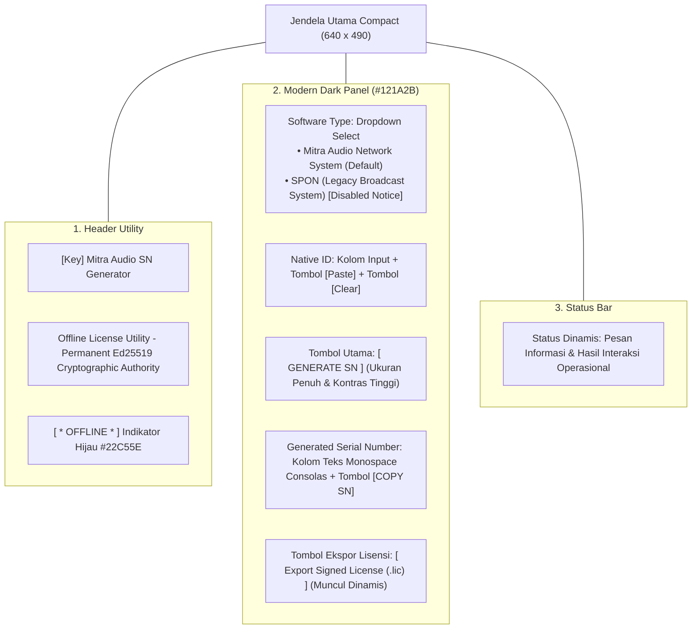

# FINAL GUI CORRECTION REPORT — MITRA AUDIO SN GENERATOR
**Dokumen:** `FINAL_GUI_CORRECTION_REPORT.md`  
**Proyek:** Mitra Audio Network System  
**Workspace:** `C:\IPNBS`  
**Status Evaluasi:** PASS (Redesign Selesai, Build Sukses, Regresi Sukses, User Acceptance PENDING)

---

## 1. Ringkasan Revisi Antarmuka Pengguna (GUI Redesign)

Sesuai arahan **FINAL GUI CORRECTION**, antarmuka Vendor SN Generator telah dirombak secara presisi menjadi **aplikasi key generator desktop klasik yang ringkas (*compact single-window utility*)**:

1. **Penghapusan Seluruh Elemen Web/Admin Dashboard:**
   - Menghapus sidebar navigasi kiri.
   - Menghapus menu Dashboard statistik, tabel transaksi, grafik, dan riwayat audit.
   - Menghapus menu navigasi terpisah (License Issuer, License Verification, Issuance History, Customer Records, Support & Replacement).
   - Menghapus kolom input Product ID (ditentukan secara otomatis di internal).
   - Menghapus input Edition dan License Duration (kebijakan tetap lisensi permanen).

2. **Penerapan Gaya Visual Modern Dark Desktop Utility:**
   - **Background Utama:** `#0B1020` (Dark Navy Black).
   - **Container Panel Berbingkai Halus:** `#121A2B` dengan border `#192438` dan radius sudut modern (*Rounded Rectangle*).
   - **Warna Teks & Aksen:** Teks utama `#F8FAFC`, teks pembantu `#94A3B8`, aksen judul Cyan `#38BDF8`, dan Electric Blue `#3B82F6`.
   - **Ukuran Jendela Compact:** `640 x 490` piksel (proporsional khas software licensing utility vendor).

---

## 2. Susunan Elemen GUI Final (Single-Window Compact Layout)

### Logika Produk Terintegrasi:
- **Mitra Audio Network System:** Pembangkitan SN format `MANS-<PROD>-<HASH>-<HASH>-<CHKS>`, penerbitan payload Ed25519 permanen di memori otoritas, dan tombol ekspor `.lic` aktif secara instan.
- **SPON (Legacy System):** Apabila dipilih pada dropdown, sistem menampilkan notifikasi proteksi integritas: *Penerbitan SN SPON dinonaktifkan sementara karena algoritma resmi belum diverifikasi (sesuai ADR-015/ADR-016)*. Mitra Audio menolak pembuatan serial number palsu untuk sistem warisan.

---

## 3. Bukti Tangkapan Layar GUI Final

Tangkapan layar aktual yang diekstraksi langsung dari proses jendela Windows hasil build release:

- **Screenshot Utama:**  
  [`docs/poc/license-generator-gui/screenshots/01_vendor_sn_generator_compact_dark.png`](file:///c:/IPNBS/docs/poc/license-generator-gui/screenshots/01_vendor_sn_generator_compact_dark.png)  
  *(Format PNG, Resolusi 640x490, Tema Modern Dark Desktop Utility)*

---

## 4. Hasil Verifikasi & Regresi Menyeluruh

- **Toolchain Rust:**
  - `cargo fmt --check`: Clean (Exit code 0).
  - `cargo clippy --workspace --all-targets -- -D warnings`: Clean (0 errors, 0 warnings).
  - `cargo test --workspace`: 20 dari 20 automated tests lulus 100% (termasuk test harness registrasi pelanggan `e2e_gui_poc_tests.rs`).
- **Pemisahan Paket & Keamanan Klien:**
  - Aplikasi pelanggan `dist/customer/MitraAudio-Network-System/MitraAudio-Network-System.exe` tidak mengalami perubahan dan tetap terverifikasi murni membawa public key 32-byte.
- **Preservation Lock:**
  - SHA-256 seluruh biner legacy dan installer cocok 100% dengan baseline awal.
  - Direktori `C:\asl` dan `C:\mitraOS` bebas modifikasi.
- **Stop Directive:**
  - Phase 1 Batch 3 belum dimulai.
  - Status User Acceptance tetap **PENDING** menunggu evaluasi dan persetujuan langsung dari User.
