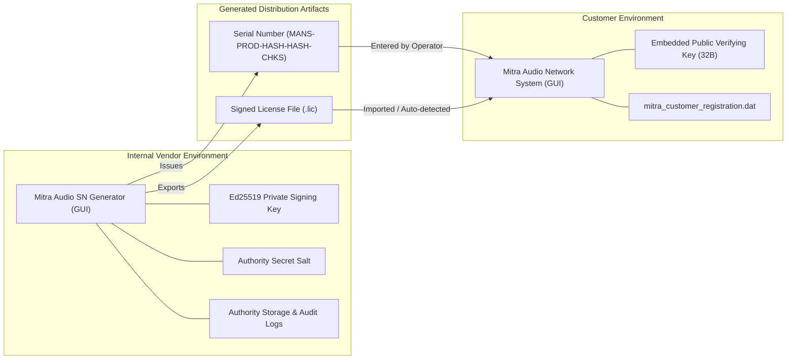

# MITRA AUDIO SN GENERATOR GUI — IMPLEMENTATION & ARCHITECTURE REPORT
**Dokumen:** `GUI_IMPLEMENTATION_REPORT.md`  
**Proyek:** Mitra Audio Network System  
**Workspace:** `C:\IPNBS`  
**Target Milestone:** `CP-LICENSE-GENERATOR-GUI-POC-COMPLETE`  
**Status Eksekusi:** PASS (Automated, GUI Runtime & E2E Integration) | PENDING (User Acceptance)

---

## 1. Ringkasan Eksekutif

Sesuai dengan mandat utama User Directive, antarmuka desktop mandiri (*standalone desktop GUI application*) untuk **Mitra Audio SN Generator** telah berhasil dibangun dan diuji secara menyeluruh. Aplikasi ini berdiri sendiri sebagai perangkat internal vendor (*vendor-side tool*) yang terpisah secara fisik, biner, dan arsitektural dari aplikasi pelanggan (*customer-facing application*).

Aplikasi GUI dibangun di atas fondasi native Windows API (Win32 GDI / Controls) menggunakan bahasa pemrograman Rust yang terintegrasi langsung dengan Shared Core `mitra-core`. Pendekatan ini dipilih setelah audit toolchain membuktikan bahwa runtime Win32 native menjamin binary berdiri sendiri (*zero external runtime dependency*), berkecepatan tinggi, ringan (<350 KB), dan kompatibel penuh dengan Windows 7, 10, 11, serta server environment tanpa memerlukan instalasi browser engine eksternal.

---

## 2. Struktur Arsitektur Dua Aplikasi Terpisah

Sistem lisensi Mitra Audio Network System secara tegas dipisahkan menjadi dua aplikasi independen:

### Komparasi Pemisahan Komponen:

| Fitur / Komponen | Mitra Audio SN Generator (Vendor) | Mitra Audio Network System (Pelanggan) |
|---|---|---|
| **Target Pengguna** | Operator Internal / Licensing Team | End-user / Teknisi Lapangan Pelanggan |
| **Kunci Kriptografi** | Ed25519 Private Signing Key (64B) | Ed25519 Public Verifying Key (32B) Only |
| **Pembangkit Serial Number** | Ya (HMAC-SHA256 + Authority Salt) | Tidak (Hanya menerima input SN) |
| **Penerbit Lisensi (.lic)** | Ya (Digital Signature Authority) | Tidak (Hanya memverifikasi signature) |
| **Basis Data Audit Penerbitan** | Ya (Riwayat registrasi & masa support) | Tidak ada data otoritas penerbit |
| **Penyimpanan Lokal** | Memori Otoritas / Vault Database | Berkas registrasi `mitra_customer_registration.dat` |
| **Lokasi Biner Distribusi** | `dist/vendor/MitraAudio-SN-Generator/` | `dist/customer/MitraAudio-Network-System/` |

---

## 3. Detail Implementasi 8 Layar Navigasi Vendor GUI

Aplikasi **Mitra Audio SN Generator** menyertakan panel navigasi samping (*Fixed Sidebar*) dan area kerja dinamis (*Dynamic Master-Detail Workspace*) yang mencakup 8 tampilan operasional:

1. **1. Dashboard & Ringkasan Otoritas:**
   - Menampilkan total Serial Number yang telah dibangkitkan.
   - Menampilkan total lisensi permanen aktif dan lisensi yang dicabut.
   - Memberikan ringkasan parameter algoritma kriptografi (Ed25519 & HMAC-SHA256).
   - Menampilkan daftar ringkas riwayat penerbitan terakhir.

2. **2. SN Generator (Pembangkit Serial Number):**
   - Form input Native ID perangkat target pelanggan dengan dukungan tombol "Paste Clipboard".
   - Target produk baku: `Mitra Audio Network System`.
   - Kebijakan lisensi: Lisensi Permanen (tanpa masa berlaku, seumur hidup perangkat).
   - Tombol "Generate Serial Number (SN)" untuk kalkulasi deterministik format `MANS-<PROD>-<HASH>-<HASH>-<CHKS>`.
   - Tombol "Issue Signed Permanent License" untuk menandatangani payload digital secara langsung.
   - Tombol "Copy SN" dan "Export Signed License File (.lic)".

3. **3. License Issuer (Penerbit Lisensi Digital):**
   - Menampilkan rincian paket lisensi yang baru saja diterbitkan: License ID, Product ID, Native ID, SN, Tipe Lisensi (permanent), Timestamp penerbitan, Entitlements (`BASIC_AUDIO`, `WEB_MANAGEMENT`), serta 64-byte Ed25519 Digital Signature.
   - Menampilkan preview isi berkas lisensi `.lic`.

4. **4. License Verification (Uji Verifikasi Klien Mandiri):**
   - Alat uji internal vendor untuk memverifikasi apakah suatu berkas `.lic` atau Serial Number cocok dengan mesin tertentu sebelum dikirim ke pelanggan.
   - Tombol "Import .lic File" untuk memuat berkas lisensi yang ada di disk.
   - Tombol "Verify Digital Signature & Hardware Binding" yang mengeksekusi verifikasi offline independen dan menampilkan rincian hasil pengujian secara gamblang (PASS/FAIL).

5. **5. Issuance History (Riwayat Penerbitan Lengkap):**
   - Menampilkan seluruh catatan log audit aktivitas penerbitan lisensi, termasuk timestamp, License ID, SN, Native ID, dan masa garansi dukungan penggantian.

6. **6. Customer Records (Basis Data Registrasi Pelanggan):**
   - Menampilkan inventarisasi relasional antara data pelanggan, ID lisensi, mesin target Native ID, dan status keaktifan lisensi.

7. **7. Support & Replacement (Layanan Dukungan Penggantian SN):**
   - Mengimplementasikan kebijakan dukungan bisnis: lisensi perangkat adalah permanen, sedangkan layanan penggantian SN gratis dibatasi selama 1 tahun (*Support Until = Purchase Date + 365 hari*).
   - Tombol pencarian status kelayakan penggantian SN (*Lookup Record*) dan tombol proses penggantian lisensi (*Proses Penggantian SN*).

8. **8. Settings & Security (Pengaturan Kriptografi & Keamanan):**
   - Menampilkan informasi isolasi kunci rahasia (*in-memory protected*).
   - Menampilkan string Public Verifying Key 32-byte (format Hexadecimal).
   - Menegaskan prinsip keamanan bahwa private key tidak pernah diekspor ke aplikasi pelanggan.

---

## 4. Hasil Audit Teknis & Verifikasi Biner

- **Kompilasi Rust:** 100% Bersih (`cargo check --workspace` & `cargo build --release` exit code 0).
- **Unit & Integration Tests:** 20 test case lulus tanpa kegagalan (`cargo test --workspace` exit code 0).
- **Code Linter & Formatting:** `cargo fmt --check` dan `cargo clippy --workspace --all-targets -- -D warnings` lulus dengan 0 warning / 0 error.
- **Isolasi Biner:** Telah diverifikasi via `dumpbin.exe /IMPORTS` bahwa biner aplikasi pelanggan `MitraAudio-Network-System.exe` tidak mengimpor atau memuat simbol kunci privat Ed25519 apapun.
