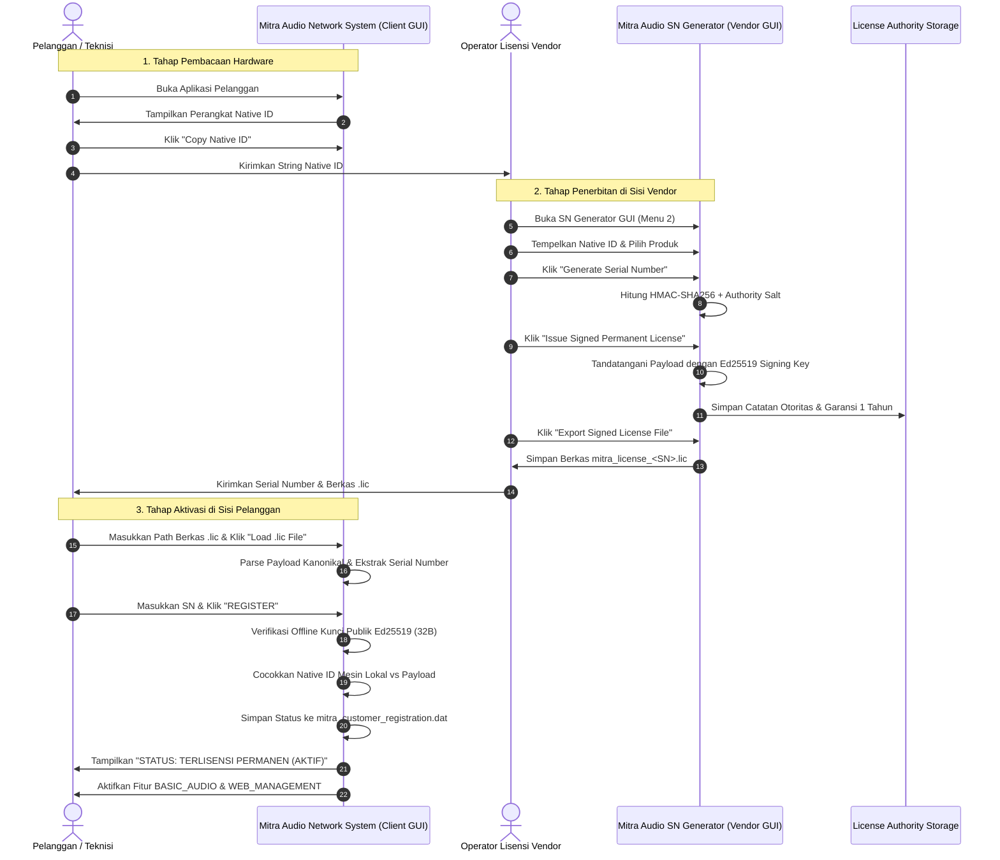

# ALUR KERJA PENERBITAN LISENSI — MITRA AUDIO NETWORK SYSTEM
**Dokumen:** `LICENSE_ISSUANCE_WORKFLOW.md`  
**Proyek:** Mitra Audio Network System  
**Format Serial Number:** `MANS-<PROD4>-<HASH4>-<HASH4>-<CHK4>` (24 Karakter)  
**Format Berkas Lisensi:** Text Kanonikal Bertanda Tangan Ed25519 (`.lic`)

---

## 1. Diagram Alir Penerbitan & Aktivasi End-to-End



---

## 2. Struktur Payload Berkas Lisensi Distribusi

Berkas `.lic` yang diekspor oleh vendor memiliki format berikut:

```text
MITRA_AUDIO_LICENSE_V1
PAYLOAD=V1|LIC-1731380000|MITRA-AUDIO-SERVER|WIN-HWID-V1:MB-...:CPU-...:DISK-...|MANS-MITR-A1B2-C3D4-E5F6|1731380000|permanent|BASIC_AUDIO,WEB_MANAGEMENT|MITRA-AUTHORITY-ROOT
SIGNATURE=7C8F9E... (128 karakter Hexadecimal mewakili 64-byte Ed25519 Signature)
```

### Properti Utama:
1. **Permanen:** Bidang `license_type` wajib bernilai `"permanent"`. Tidak ada batasan tanggal kadaluarsa (*expiry timestamp*) di dalam payload.
2. **Keterikatan Kuat:** Payload secara eksplisit mengikat `product_id` dan `native_id`. Memodifikasi satu karakter pun akan menyebabkan verifikasi tanda tangan digital Ed25519 gagal total.
3. **Pemberian Hak Fitur (*Entitlements*):** Fitur seperti antarmuka web konsol (`WEB_MANAGEMENT`) hanya diizinkan aktif jika string tersebut tercantum secara eksplisit dalam daftar entitlement yang ditandatangani.
