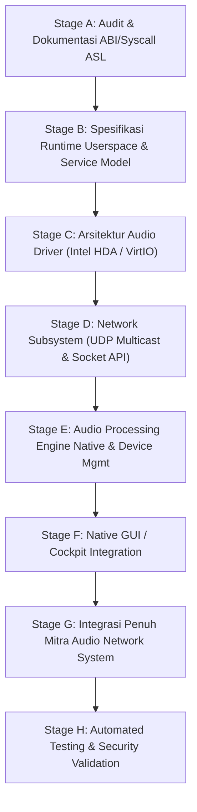

# MITRAOS / ASL KERNEL DEVELOPMENT ROADMAP — PHASE 0.1
## MITRA AUDIO NETWORK SYSTEM

**Tanggal:** 2026-11-11  
**Target:** Integrasi Native MitraOS Berbasis ASL Kernel (Priority 4)  
**Status Kebijakan:** Gap pengembangan adalah normal dan direncanakan secara bertahap tanpa mengorbankan stabilitas Priority 1-3.  

---

### 1. Hasil Audit Kesiapan ASL Kernel Aktual (`C:\asl`)

- **Kernel Core:** Bare-metal Rust (`no_std`), bootloader Limine, memori paging & heap allocator (`asl-memory`), scheduler round-robin/priority (`asl-sched`).
- **Subsystem Khusus:** Memiliki AFDX IPC, TCAM, Security Vault, MPU.
- **Audio Subsystem:** **NOT IMPLEMENTED** (Belum ada driver soundcard).
- **Network Sockets Userspace:** **NOT IMPLEMENTED** (Terdapat komponen L2/L3 TCAM/AFDX, namun belum ada BSD Socket layer userspace).

---

### 2. Roadmap Pengembangan Bertahap (Stage A hingga Stage H)

#### Rincian Setiap Tahapan:

1. **Stage A — Audit & Spesifikasi ABI/Syscall:**
   - Menentukan interface system call x86_64 (`syscall` / `sysret`) untuk interaksi userspace-ke-kernel di ASL.
   - Menentukan format biner executable native (ELF64 statis tanpa dependensi GNU glibc).
2. **Stage B — Userspace Application Runtime & Service Model:**
   - Membangun `asl-crt` (C Runtime minimal atau Rust runtime `no_std` dengan custom allocator).
   - Menetapkan lifecycle service background (mirip init process sederhana).
3. **Stage C — Desain Arsitektur Driver Audio Native:**
   - Implementasi driver PCI untuk Intel High Definition Audio (HDA) / AC97 / VirtIO-Sound.
   - Menyediakan circular DMA ring buffer untuk transmisi sample audio dari userspace ke hardware.
4. **Stage D — Subsystem Jaringan & Socket API:**
   - Menghubungkan driver PCI Ethernet (misal Intel e1000 atau VirtIO-Net) ke network stack IP minimal.
   - Menyediakan antarmuka socket untuk UDP Multicast (`join_multicast_group`, `send_to`, `recv_from`).
5. **Stage E — Integrasi Engine Audio Mitra:**
   - Mengompilasi Shared Core Rust dengan target bare-metal MitraOS.
   - Menguji streaming broadcast audio PCM tanpa distorsi.
6. **Stage F — Desain GUI / Cockpit Integration:**
   - Integrasi antarmuka visual melalui `asl-cockpit-shell` atau framebuffer display server native.
7. **Stage G — Integrasi Sistem Penuh:**
   - Pengoperasian lengkap: routing matrix, zones, license check, streaming multicast.
8. **Stage H — Pengujian & Validasi Keamanan:**
   - Automated fuzzing pada packet parser, validasi isolasi memori kernel-userspace, benchmark latency.
