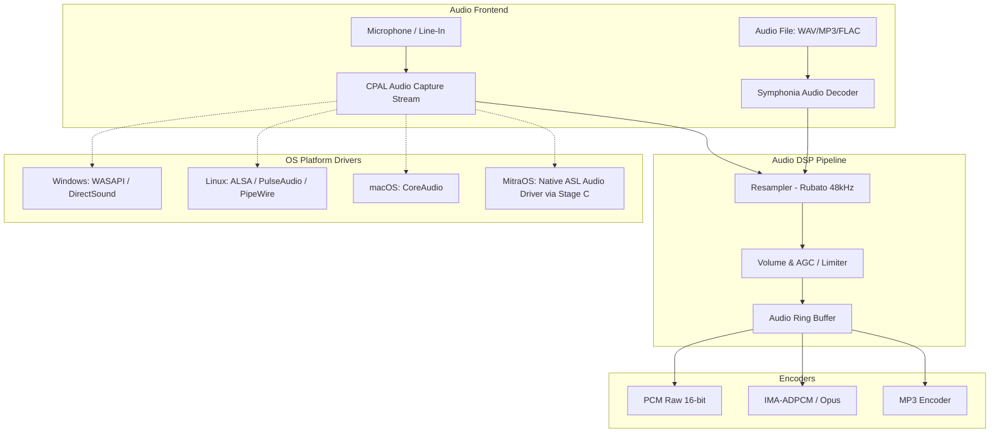

# PHASE 0.2 — BATCH C: AUDIO ENGINE & CODEC DEEP AUDIT

**Target Subsystem:** Audio In/Out Engine (`CACMInCtrl`, WinMM, ACM, LAME MP3)  
**Host Executable:** `IPNBS_Server.exe` (`0x004010C0` - `0x00401E40`)  
**Associated Libraries:** `winmm.dll`, `msacm32.dll`, `lame_enc.dll`  
**Analysis Provider:** Ghidra 12.1.4 + `IPNBS_Server.map`

---

## 1. Arsitektur Audio Capture Legacy (`CACMInCtrl`)

Objek `CACMInCtrl` bertanggung jawab mengambil audio stream dari mikrofon server atau line-in soundcard untuk di-broadcast ke jaringan IP.

### 1.1 Siklus Hidup Audio In

1. **Inisialisasi (`CACMInCtrl::Open` - `0x00401530`):**
   - Mengisi struktur format `WAVEFORMATEX`:
     - `wFormatTag = WAVE_FORMAT_PCM` (`0x0001`).
     - `nChannels = 1` (Mono) atau `2` (Stereo).
     - `nSamplesPerSec`: `11025`, `22050`, atau `44100` Hz (dapat dikonfigurasi).
     - `wBitsPerSample = 16`.
     - `nBlockAlign = nChannels * (wBitsPerSample / 8)`.
     - `nAvgBytesPerSec = nSamplesPerSec * nBlockAlign`.
   - Memanggil Win32 API:
     ```c
     waveInOpen(&m_hWaveIn, WAVE_MAPPER, &wfx, (DWORD_PTR)waveInProc, (DWORD_PTR)this, CALLBACK_FUNCTION);
     ```
2. **Buffer Ring Queue (`CACMInCtrl::NewHeader` - `0x004016A0`):**
   - Mengalokasikan 4 buah `WAVEHDR` buffer melingkar.
   - Ukuran buffer default: **1,024 byte s/d 2,048 byte** (mencerminkan ~23ms s/d 46ms latency per frame pada 22.05 kHz 16-bit).
   - Memanggil `waveInPrepareHeader` dan `waveInAddBuffer` untuk memasukkan buffer ke antrean kernel driver sound card.
3. **Audio In Callback (`waveInProc`):**
   - Menangani event message:
     - `WIM_OPEN`: Soundcard terbuka.
     - `WIM_DATA`: Buffer terisi penuh dengan sampel PCM mentah.
     - `WIM_CLOSE`: Soundcard ditutup.
   - Pada event `WIM_DATA`:
     - Buffer PCM diteruskan ke fungsi kompresi audio / encoder (`InitEncoder` / `EncodeChunk`).
     - Buffer diisi ulang dan didaftarkan kembali ke driver dengan `waveInAddBuffer`.
4. **Shutdown (`CACMInCtrl::Close` - `0x00401750`):**
   - Memanggil `waveInReset(m_hWaveIn)`.
   - Memanggil `waveInUnprepareHeader` untuk seluruh header.
   - Memanggil `waveInClose(m_hWaveIn)`.

---

## 2. Audio Encoders & Formats

Legacy server mendukung 3 mode pengkodean audio:

| Format Code | Nama Format | Sample Rate | Bitrate | Latency | Keterangan |
|---|---|---|---|---|---|
| `0x0001` | Raw PCM 16-bit | 11.025 / 22.05 / 44.1 kHz | 176 - 705 kbps | Rendah (~20ms) | Kualitas tinggi, konsumsi bandwidth tinggi |
| `0x0002` | IMA ADPCM 4-bit | 11.025 / 22.05 kHz | 44 - 88 kbps | Sangat Rendah (~20ms) | Format kompresi default interkom suara |
| `0x0055` | MPEG Layer-3 (MP3) | 22.05 / 44.1 kHz | 32 - 128 kbps | Sedang (~60-100ms) | Menggunakan engine `lame_enc.dll`, cocok untuk musik latar/BGM |

---

## 3. Desain Modern Audio Engine (Cross-Platform Shared Core)

Untuk menggantikan WinMM yang hanya ada di Windows, dirancang abstraksi **CPAL (Cross-Platform Audio Library)** dan **Symphonia / Rubato** dalam Rust:



### Keunggulan Desain Modern:
1. **Low Latency WASAPI Exclusive / Shared** di Windows (menggantikan WinMM era Windows 95).
2. **Native ALSA & PipeWire** di Linux.
3. **CoreAudio** di macOS.
4. **Opus Audio Codec:** Menyediakan opsi codec modern ultra-low-latency (5ms) dengan kualitas suara superior dan packet loss concealment (PLC), dengan tetap mempertahankan codec legacy IMA-ADPCM untuk kompatibilitas perangkat hardware lama.
