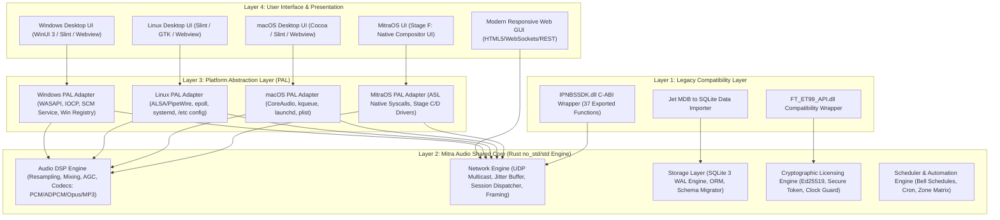

# PHASE 0.2 — CROSS-PLATFORM SYSTEM SPECIFICATION & ARCHITECTURE DESIGN

**Project:** Mitra Audio Network System  
**Document Code:** `SPEC-CROSS-PLATFORM-ARCH-V1`  
**Target Architecture:** Rust Core + Platform Adapters + Native UI / Web GUI  

---

## 1. Prinsip Desain & Hierarki Platform

Pengembangan Mitra Audio Network System mematuhi urutan prioritas yang ketat:
1. **Windows (Prioritas 1):** Lingkungan operasional utama saat ini; kompatibilitas backwards biner dan kelancaran transisi adalah prioritas tertinggi.
2. **Linux (Prioritas 2):** Server headless / desktop environment standar industri (Ubuntu, Debian, RHEL) untuk deployment broadcast server terpusat.
3. **macOS (Prioritas 3):** Desktop workstation untuk operator broadcast berbasis Apple silicon (ARM64) dan Intel (x86_64).
4. **MitraOS berbasis ASL Kernel (Prioritas 4):** Sistem operasi masa depan independen yang dikembangkan secara bertahap (Stage A s/d Stage H).

---

## 2. Rincian Platform Adapter

### 2.1 Windows Platform Adapter (Priority 1)
- **Audio Backend:** WASAPI (Windows Audio Session API) dengan fallback DirectSound / WinMM.
- **Network Backend:** Windows Sockets 2 (`WSASocket`, IOCP / `wepoll` terintegrasi async tokio).
- **Service Integration:** Windows Service Control Manager (SCM) untuk running sebagai background daemon `MitraAudioService`.
- **Packaging:** MSI / Inno Setup modern installer dengan automatic prerequisite detector, registry handler, dan automatic migration tool.

### 2.2 Linux Platform Adapter (Priority 2)
- **Audio Backend:** ALSA Native & PipeWire / PulseAudio via CPAL.
- **Network Backend:** Native Linux `epoll` + POSIX sockets dengan `SO_BINDTODEVICE` dan multicast loop flags.
- **Service Integration:** `systemd` unit files (`mitra-audio.service`) dengan watchdogs.
- **Packaging:** Debian package (`.deb`), RPM package (`.rpm`), dan AppImage standalone.

### 2.3 macOS Platform Adapter (Priority 3)
- **Audio Backend:** Apple CoreAudio dengan low-latency HAL unit.
- **Network Backend:** BSD sockets dengan `kqueue` async dispatch.
- **Service Integration:** Apple `launchd` daemon (`com.mitra.audionetwork.plist`).
- **Packaging:** Signed and notarized Universal DMG (`.dmg`) bundle.

### 2.4 MitraOS / ASL Kernel Platform Adapter (Priority 4)
- **Status:** Sistem Operasi independen (bukan distro Linux, bukan POSIX emulation).
- **Pendekatan Pengembangan:** 8-Stage Sequential Roadmap:
  - **Stage A (Kernel Discovery & ABI Contract):** Audit syscall interface, memory paging, format ELF / custom binary loader ASL Kernel.
  - **Stage B (Runtime Support):** Menghubungkan Rust `core` / `alloc` ke ASL memory allocation syscalls (`sys_mmap` / `sys_brk`).
  - **Stage C (Audio Architecture):** Spesifikasi audio buffer interface kernel ASL (ring-buffer DMA audio).
  - **Stage D (Networking & Multicast):** Integrasi TCP/IP stack (e.g. `smoltcp` bare-metal) dengan driver kartu jaringan ethernet ASL.
  - **Stage E (Audio Processing Engine):** Porting DSP engine Shared Core ke atas ASL runtime.
  - **Stage F (Native Application & GUI):** Integrasi antarmuka visual native MitraOS compositor.
  - **Stage G (Mitra Audio Integration):** Deployment lengkap Mitra Audio Network pada MitraOS.
  - **Stage H (Verification & Validation):** Pengujian ketahanan, stabilitas, dan performa real-time audio.
