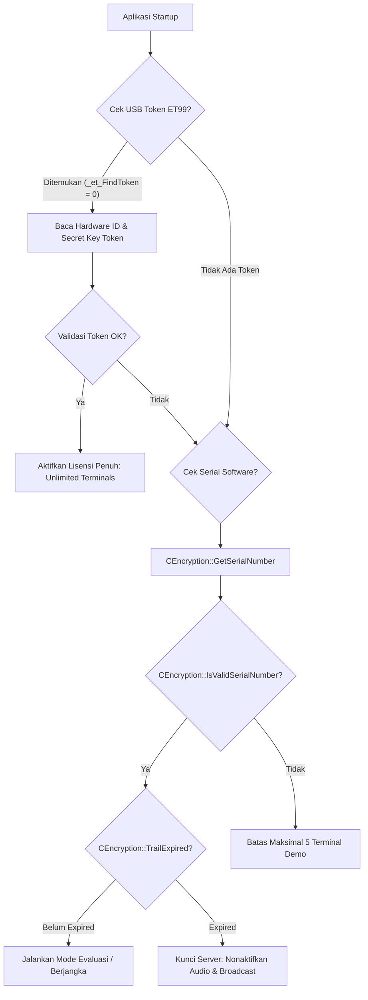

# PHASE 0.2 — BATCH E: LICENSING & NATIVE HARDWARE ID ARCHITECTURE AUDIT

**Target Components:** `CEncryption` (`IPNBS_Server.exe` @ `0x00437320`), `FT_ET99_API.dll`  
**License Formats:** Dongle Hardware USB Token (`ET99`), Software Serial Number / Limit Date  
**Associated File:** `FT_ET99_API.dll` (SHA-256: `7DCBC2C408060B7C5E9A7EAF46E177F647F818D2C963847B7D6D78F34AB33BDE`)  
**Analysis Provider:** Ghidra 12.1.4 + `IPNBS_Server.map`

---

## 1. Arsitektur Lisensi Legacy

Sistem legacy menggunakan pendekatan verifikasi lisensi ganda:



### 1.1 USB Dongle Hardware Token (`FT_ET99_API.dll`)
- Menggunakan driver Feitian ET99 USB Smart Dongle.
- Pemanggilan API inti:
  - `_et_FindToken@8`: Mencari dongle yang terpasang di bus USB host.
  - `_et_OpenToken@12`: Membuka sesi komunikasi token menggunakan PIN otentikasi.
  - `_et_Read@20`: Membaca memory EEPROM aman di dalam dongle yang menyimpan alokasi kapasitas lisensi terminal (e.g. 50, 100, 500 endpoints).
  - `_et_CloseToken@4`: Menutup handle sesi token.

### 1.2 Software Machine Fingerprinting (`CEncryption::GetSerialNumber`)
- Jika USB dongle tidak ada, sistem membaca identitas mesin:
  - Menanyakan nomor seri fisik hard drive menggunakan `DeviceIoControl` dengan control code `SMART_GET_VERSION` / `IOCTL_STORAGE_QUERY_PROPERTY`.
  - Mengambil MAC Address network card utama melalui `GetAdaptersInfo`.
  - Menggabungkan string hardware dan melakukan hashing untuk menghasilkan Machine Code / Native ID unik.
- Format Serial Lisensi:
  - Format kode 24 s/d 32 karakter terbagi menjadi beberapa grup: `XXXX-XXXX-XXXX-XXXX-XXXX`.
  - Di-decode dengan `CEncryption::DecodeLicense`:
    - Mengandung tanggal batas aktif (`GetLimitDay`), batas jumlah terminal terdaftar (`g_iMaxLogNumber`), dan bitmask fitur yang diaktifkan.

---

## 2. Masalah Kritis Arsitektur Lisensi Legacy
1. **Ketergantungan Driver Windows 32-bit:** `FT_ET99_API.dll` adalah library proprietary x86 Windows lama yang tidak memiliki driver resmi untuk Linux modern, macOS modern (Apple Silicon ARM64), maupun MitraOS.
2. **Kerapuhan Machine ID:** Pergantian disk drive, VM migration, atau penambahan adapter VPN dapat mengubah Machine ID lama dan merusak lisensi valid.
3. **Ketiadaan Enkripsi Asimetris:** Algoritma serial legacy menggunakan symmetric key sederhana yang rentan terhadap keygen atau manipulasi tanggal sistem (clock rollback).

---

## 3. Desain Arsitektur Lisensi Baru (Modern Cross-Platform)

Untuk arsitektur modern Mitra Audio Network System, lisensi direkayasa ulang dengan standar kriptografi industri tanpa merusak kepatuhan backwards compatibility:

### 3.1 Spesifikasi Lisensi Asimetris Ed25519
- **Kriptografi:** Elliptic Curve Digital Signature Algorithm (Ed25519) + ChaCha20-Poly1305.
- **Format Berkas Lisensi:** JSON Web Signature (JWS) atau binary token terkompresi Base64 (`.lic`).
- **Isi Payload Lisensi:**
  ```json
  {
    "issuer": "Mitra Audio Network Authority",
    "customer_name": "PT Mitra IP Network Indonesia",
    "license_tier": "Enterprise",
    "max_terminals": 500,
    "max_channels": 32,
    "features": ["multicast", "intercom", "fire_alarm", "recording", "rest_api"],
    "valid_from": "2026-01-01T00:00:00Z",
    "valid_until": "2030-12-31T23:59:59Z",
    "hardware_binding": {
      "platform": "windows",
      "machine_fingerprint_sha256": "e3b0c44298fc1c149afbf4c8996fb92427ae41e4649b934ca495991b7852b855"
    },
    "signature_ed25519": "..."
  }
  ```

### 3.2 Cross-Platform Hardware Fingerprint Generator
Mesin abstraksi hardware (`HardwareIdProvider`) di Rust:
- **Windows:** CPU ID + Motherboard UUID (via WMI/SMBIOS) + System Drive Serial.
- **Linux:** `/etc/machine-id` + DMI product UUID (`/sys/class/dmi/id/product_uuid`).
- **macOS:** IOKit `IOPlatformUUID`.
- **MitraOS (Stage A/B):** ASL Kernel Machine GUID via native syscall.

### 3.3 Kompatibilitas Legacy Drop-in
- DLL Wrapper `FT_ET99_API.dll` modern yang dapat mensimulasikan token virtual atau memvalidasi Ed25519 license file secara transparan bagi aplikasi binary yang masih memanggil API lama.
