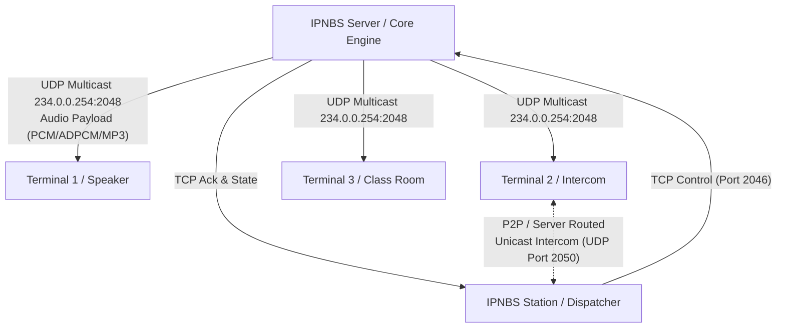

# PHASE 0.2 — BATCH D: NETWORK PROTOCOL & PACKET STRUCTURE SPECIFICATION

**Target Subsystem:** IP Audio Network Protocols & Multicast Transport  
**Host Components:** `IPNBS_Server.exe` (`CChannel`, `CNetCore`), `IPNBSSDK.dll`  
**Network Layers:** UDP Multicast, TCP Stream Control, IOCP Dispatcher  
**Multicast Group:** `234.0.0.254` (Default Control: `2046`, Default Audio: `2048`)  
**Analysis Provider:** Ghidra 12.1.4 + `IPNBS_Server.map`

---

## 1. Topologi Jaringan & Alur Komunikasi

Sistem IP Audio Network beroperasi menggunakan model hybrid **TCP Control + UDP Multicast/Unicast Audio**:



---

## 2. Struktur Datagram Paket Audio UDP (`tagDGRAMHEADER`)

Berdasarkan rekonstruksi layout memory dari `CChannel::SendTo` (`0x00404C50`) dan `tagDGRAMHEADER`:

```c
#pragma pack(push, 1)
typedef struct _tagDGRAMHEADER {
    uint8_t   bySyncByte;       // 0x00: Magic Sync Byte (0x5A / 0xA5)
    uint8_t   byPacketType;     // 0x01: 0x01=Audio, 0x02=Control, 0x03=Heartbeat, 0x04=Alarm
    uint16_t  wChannelID;       // 0x02: Broadcast Channel ID (0x0001 - 0xFFFF)
    uint32_t  dwSequenceNumber; // 0x04: Sequence packet counter untuk deteksi packet loss / jitter
    uint16_t  wPayloadSize;     // 0x08: Panjang payload audio dalam bytes (biasanya 512 / 1024)
    uint8_t   byAudioCodec;     // 0x0A: 0x01=PCM, 0x02=ADPCM, 0x03=MP3, 0x04=Opus (Modern)
    uint8_t   bySampleRateCode; // 0x0B: 0x01=11025Hz, 0x02=22050Hz, 0x03=44100Hz, 0x04=48000Hz
    uint8_t   byPriority;       // 0x0C: 0x01=BGM (Low), 0x02=Call (Normal), 0x03=Fire Alarm (Emergency)
    uint8_t   byReserved;       // 0x0D: Alignment pad
    uint16_t  wChecksum;        // 0x0E: 16-bit CRC / Checksum paket
    // Offset 0x10 (16 bytes): Payload Audio Data dimulai di sini
} tagDGRAMHEADER;
#pragma pack(pop)
```

### Penjelasan Field Kunci:
1. **Magic Sync Byte (`0x5A`):** Memastikan parser tidak memproses frame acak akibat noise jaringan.
2. **Channel ID (`wChannelID`):** Mengizinkan hingga 65.535 channel audio independen di jaringan multicast. Terminal hanya merender audio jika terminal tersebut di-assign ke channel yang bersangkutan.
3. **Priority Level (`byPriority`):**
   - **Level 1 (BGM):** Audio latar musik.
   - **Level 2 (Normal Broadcast):** Pengumuman manual atau jadwal bel sekolah/kantor.
   - **Level 3 (Emergency / Fire Alarm):** Memiliki hak veto langsung membungkam channel lain dan menaikkan volume terminal ke 100%.

---

## 3. Protokol TCP Control & Command Framing

Komunikasi antara Server, Station, dan Terminal dikemas dalam format length-prefixed packet:

```text
+----------------+----------------+----------------+--------------------+
| Packet Length  | Command Code   | Session / Term | Command Payload    |
| (4 bytes LE)   | (2 bytes LE)   | (4 bytes LE)   | (Variable bytes)   |
+----------------+----------------+----------------+--------------------+
```

### Daftar Command Code Utama:
- `0x1001` - `CMD_LOGIN_REQ`: Request otentikasi station ke server.
- `0x1002` - `CMD_LOGIN_RESP`: Konfirmasi login dan hak akses.
- `0x2001` - `CMD_START_BROADCAST`: Memulai sesi broadcast pada channel tertentu.
- `0x2002` - `CMD_STOP_BROADCAST`: Menghentikan broadcast aktif.
- `0x3001` - `CMD_CALL_REQ`: Inisiasi interkom 2 arah.
- `0x3002` - `CMD_CALL_ACK`: Terminal tujuan merespons panggilan (ringing / busy).
- `0x3003` - `CMD_CALL_HANGUP`: Mengakhiri panggilan interkom.
- `0x4001` - `CMD_SET_GPIO`: Mengubah output pin relay remote hardware.
- `0x5001` - `CMD_HEARTBEAT`: Periodic keep-alive ping (interval default: 3 detik).

---

## 4. Modernisasi Jaringan Lintas Platform

Pada modern Shared Core (Rust):
- **Network Engine:** Dibangun di atas `tokio` (Async runtime) dan `socket2` (cross-platform socket configuration: `IP_MULTICAST_TTL`, `SO_REUSEADDR`, `IP_ADD_MEMBERSHIP`).
- **Jitter Buffer:** Implementasi adaptif jitter buffer berbasis RTP/sequence number untuk meratakan latency pada jaringan Wi-Fi / WAN.
- **Enkripsi DTLS / TLS 1.3:** Opsi pengamanan paket control dan stream audio terenkripsi untuk mencegah sniffing di jaringan publik / corporate LAN.
