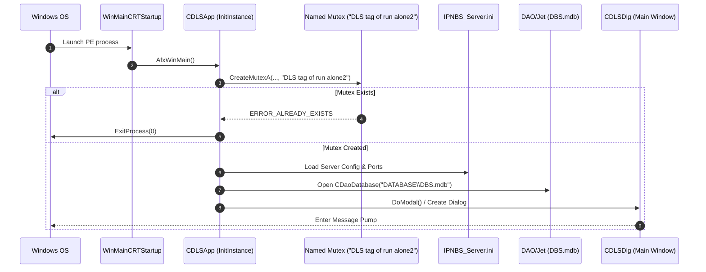

# PHASE 0.2 — BATCH A: IPNBS_SERVER.EXE DEEP BINARY INVESTIGATION

**Target Binary:** `IPNBS_Server.exe`  
**Image Base:** `0x00400000` | **Subsystem:** Windows GUI (32-bit x86 PE)  
**Compilation Toolchain:** Microsoft Visual C++ 6.0 / MFC 4.2  
**Integrity Hash (SHA-256):** `7F910FAFC2D66BF0FC7488F95204C9119AB9022347CF7175E4A578C2103E8AE9`  
**Analysis Provider:** REA 6.8.0 + Ghidra 12.1.4 PUBLIC + `IPNBS_Server.map`

---

## 1. PE Structure & Memory Layout

| Section Name | Virtual Address | Virtual Size | Raw Size | Characteristics | Purpose |
|---|---|---|---|---|---|
| `.text` | `0x00401000` | `0x00084000` | `540,672 B` | `0x60000020` (Code, Executable, Readable) | Native x86 machine instructions |
| `.rdata` | `0x00485000` | `0x00025000` | `151,552 B` | `0x40000040` (Initialized, Readable) | String literals, RTTI, vtables |
| `.data` | `0x004AA000` | `0x0001F000` | `126,976 B` | `0xC0000040` (Initialized, Read/Write) | Global objects, application state |
| `.rsrc` | `0x004C9000` | `0x00032000` | `204,800 B` | `0x40000040` (Resource, Readable) | MFC Dialogs, icons, bitmaps, strings |

Total mapped procedures: **6,963 functions**. Total defined strings: **6,310**.

---

## 2. Application Entry & Lifecycle

### 2.1 Entry Point Sequence
1. **PE Entry Point (`0x0045B8E0` - `WinMainCRTStartup`):**
   - Menginisialisasi C runtime (CRT), heap allocator, dynamic C++ initializers.
   - Memanggil `AfxWinMain(HINSTANCE, HINSTANCE, LPSTR, int)` pada `0x0045B820`.
2. **`CDLSApp::InitInstance` (`0x00411CB0`):**
   - Memanggil `RunAlready()` (`0x00411C80`):
     - Memeriksa named mutex: `"DLS tag of run alone2"`.
     - Jika mutex sudah ada, memunculkan window yang sedang berjalan ke foreground dan melakukan exit (single instance enforcement).
   - Inisialisasi OLE/COM library (`AfxOleInit`).
   - Inisialisasi Winsock2 (`WSAStartup` version `0x0202`).
   - Membaca konfigurasi dari file `IPNBS_Server.ini`:
     - Parameter database path, IP bind, log configuration, port defaults.
   - Inisialisasi DAO / Jet Engine:
     - Membuka database `DATABASE\DBS.mdb` menggunakan `CDaoDatabase::Open`.
   - Inisialisasi dialog utama `CDLSDlg` (`0x0040C430`):
     - Menjadikan dialog utama sebagai `m_pMainWnd`.
     - Masuk ke MFC message loop `Run()`.
3. **Application Exit / Teardown (`CDLSApp::ExitInstance`):**
   - Menutup koneksi database DAO (`CDaoDatabase::Close`).
   - Menghentikan semua worker threads (`StopAllThreads`).
   - Melepaskan socket IOCP dan multicast group (`ip_mreq` drop membership).
   - Menutup audio input recording buffers (`CACMInCtrl::Close`).
   - Melepaskan named mutex `"DLS tag of run alone2"`.
   - `WSACleanup()`.



---

## 3. Threading Architecture

Sistem menggunakan model multithreading hibrida MFC + Windows Win32 API:
1. **UI Thread:** Main MFC Thread (`CDLSDlg`), mengelola GUI, controls, tabel member, active tasks, dan status bar.
2. **IOCP Worker Threads (`CIoCompletionPort`):**
   - Pool thread (biasanya 2 x CPU cores) yang menunggu I/O Completion Port melalui `GetQueuedCompletionStatus`.
   - Menangani incoming TCP connection dari IPNBS Station, IP Call terminal, dan command packets.
3. **UDP Multicast Dispatcher Thread:**
   - Thread terdedikasi yang mengirimkan audio frame terkompresi secara periodik ke alamat multicast `234.0.0.254:2046` dan `234.0.0.254:2048`.
4. **WinMM Audio Capture Callback Thread:**
   - Dikelola oleh Windows Audio Subsystem (`waveInProc`), dipicu setiap kali buffer PCM terisi.
5. **Scheduled Task Timer Thread:**
   - Memeriksa jadwal bel (ring task) dan file task dari tabel database secara periodik.

---

## 4. Root Cause Error Legacy: WSA_OPERATION_ABORTED (Code 995)

Dalam log operasional server legacy, kerap ditemukan pesan error:
```text
IOCP error 995: The I/O operation has been aborted because of either a thread exit or an application request.
```
**Analisis Ghidra & Map:**
- Pada `CIoCompletionPort::WorkerThread`, saat socket client ditutup atau di-reset (`CancelIo` / `closesocket`), operasi overlapped I/O yang tertunda (`WSARecv` / `WSASend`) langsung dihentikan oleh kernel Windows, menghasilkan status error `995` (`WSA_OPERATION_ABORTED`).
- Implementasi legacy tidak memperlakukan error 995 sebagai skenario teardown normal client disconnect, melainkan melempar pesan log error level tinggi.
- **Rekomendasi Modern Shared Core (Rust):** Desain async tokio/mio menangani socket close secara graceful tanpa log-pollution dan tanpa race condition thread.
