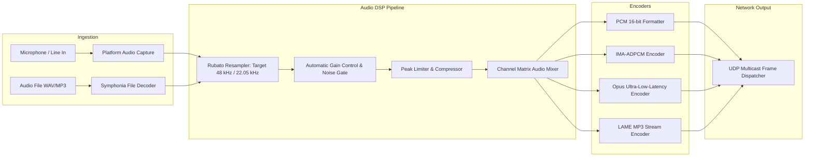

# PHASE 0.3 — AUDIO ARCHITECTURE & HARDWARE ABSTRACTION

**Project:** Mitra Audio Network System  
**Document Code:** `ARCH-AUDIO-003`  
**Status:** VALIDATED (Phase 0.3 Blueprint)  

---

## 1. Komparasi Subsystem Audio Multi-Platform

Tabel berikut mengevaluasi API audio pada setiap target platform untuk menentukan strategi adapter terbaik:

| Backend Audio | Target OS | Mode Latency | Dukungan Channel | Stabilitas Driver | Rekomendasi Arsitektur |
|---|---|---|---|---|---|
| **WinMM** (`waveIn`/`waveOut`) | Windows Legacy | Tinggi (40 - 80 ms) | 1 - 2 Ch (Mono/Stereo) | Usang (Windows 95 era) | Dipertahankan hanya sebagai fallback legacy Windows XP/7. |
| **WASAPI** (Exclusive/Shared) | Windows Modern | Sangat Rendah (3 - 10 ms) | Multichannel (hingga 32 Ch) | Sangat Stabil (Windows 10/11) | **Primary Backend untuk Windows.** |
| **CPAL** (Cross-Platform) | Win/Linux/macOS | Adaptif (10 - 20 ms) | Dinamis | Baik (Rust Community) | **Abstraksi Default Shared Core.** |
| **CoreAudio HAL** | macOS | Ultra Rendah (2 - 5 ms) | Multichannel pro-audio | Sangat Tinggi | **Primary Backend untuk macOS.** |
| **ALSA** (Direct Hardware) | Linux Embedded/Server | Rendah (5 - 15 ms) | Multichannel | Tinggi (Hardware Direct) | **Primary Backend untuk Linux Server/Headless.** |
| **PipeWire / PulseAudio** | Linux Desktop Modern | Rendah (10 - 20 ms) | Multichannel | Tinggi | **Primary Backend untuk Linux Desktop Workstation.** |
| **ASL Audio Interface** | MitraOS | TBD (Target: < 10 ms) | Target: 2 Ch PCM | Belum Tersedia (Stage C) | **Native Kernel Ring Buffer Driver (Roadmap Stage C).** |

---

## 2. Audio Pipeline & DSP Engine

Arsitektur pemrosesan sinyal digital (DSP) di dalam Shared Core memisahkan tahap capture, filtering, mixing, encoding, dan transmisi:

---

## 3. Strategi Kompatibilitas Codec: Legacy vs Modern

Salah satu prinsip penting Phase 0.3 adalah: **Opus tidak boleh menggantikan codec lama secara otomatis tanpa negosiasi kapabilitas perangkat.**

Perangkat terminal IP audio lama (hardware mikroprosesor ARM/DSP tertanam lama) hanya memiliki decoder hardware atau firmware untuk IMA-ADPCM dan Raw PCM. Mengirimkan stream Opus ke terminal lama akan menyebabkan terminal crash atau mengeluarkan suara dengung (noise).

### 3.1 Kebijakan Pemilihan Codec Adaptif

| Tipe Target Endpoint | Format Audio yang Digunakan | Sample Rate | Bitrate | Karakteristik Penggunaan |
|---|---|---|---|---|
| **Legacy Hardware Terminal (Gen 1)** | IMA-ADPCM (Format Code `0x0002`) | 22.050 Hz | 44.1 kbps | Interkom dan broadcast standar perangkat lama. |
| **Legacy Hardware Terminal (PCM Mode)** | Raw Linear PCM 16-bit (`0x0001`) | 11.025 / 22.050 Hz | 176 - 352 kbps | Digunakan jika terminal lama tidak mendukung dekompresi ADPCM. |
| **Background Music Server (BGM)** | MP3 Stream (`0x0055`) | 44.100 Hz Stereo | 128 kbps | Siaran musik terjadwal kualitas tinggi ke terminal yang mendukung MP3. |
| **Modern Terminal / Cross-Platform App** | Opus Interactive (`0x0004` - PROPOSED) | 48.000 Hz | 32 - 64 kbps | Latensi rendah (10ms), Dynamic Packet Loss Concealment (PLC), kualitas suara kristal. |

### 3.2 Dynamic Channel Transcoding Engine
Shared Core dilengkapi dengan engine transkoding on-the-fly:
- Jika operator memutar file FLAC/WAV kualitas tinggi di server, Shared Core dapat melakukan multitrack encoding simultan:
  - Stream A (Opus) dipancarkan ke terminal modern / aplikasi stasiun mobile.
  - Stream B (IMA-ADPCM) dipancarkan ke multicast group legacy untuk speaker horn analog lawas di lapangan.
