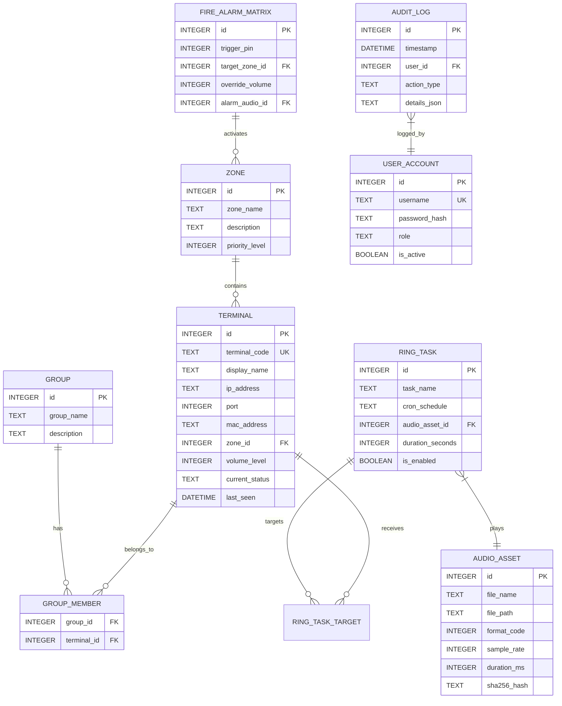

# PHASE 0.3 — DATABASE ARCHITECTURE & RELATIONAL SCHEMA SPECIFICATION

**Project:** Mitra Audio Network System  
**Document Code:** `ARCH-DATABASE-006`  
**Status:** VALIDATED (Phase 0.3 Blueprint)  
**Database Engine:** SQLite 3 (WAL Mode) via `rusqlite` / `sqlx`  

---

## 1. Relational Schema Design (Modernisasi 14 Tabel Legacy)

Berdasarkan audit simbol `CDaoRecordset*` pada Phase 0.2, struktur basis data direkayasa ulang dengan menerapkan third-normal form (3NF), integritas referensial (foreign keys), dan indexing optimal:



---

## 2. Definisi DDL Inti (SQLite 3 DDL)

```sql
-- Mengaktifkan dukungan Foreign Keys & Write-Ahead Logging
PRAGMA foreign_keys = ON;
PRAGMA journal_mode = WAL;
PRAGMA synchronous = NORMAL;

CREATE TABLE IF NOT EXISTS zones (
    id INTEGER PRIMARY KEY AUTOINCREMENT,
    zone_name TEXT NOT NULL UNIQUE,
    description TEXT,
    created_at DATETIME DEFAULT CURRENT_TIMESTAMP
);

CREATE TABLE IF NOT EXISTS terminals (
    id INTEGER PRIMARY KEY AUTOINCREMENT,
    terminal_code TEXT NOT NULL UNIQUE,
    display_name TEXT NOT NULL,
    ip_address TEXT NOT NULL,
    port INTEGER NOT NULL DEFAULT 2046,
    mac_address TEXT,
    zone_id INTEGER REFERENCES zones(id) ON DELETE SET NULL,
    default_volume INTEGER DEFAULT 80 CHECK(default_volume BETWEEN 0 AND 100),
    is_active BOOLEAN DEFAULT 1,
    created_at DATETIME DEFAULT CURRENT_TIMESTAMP
);

CREATE INDEX IF NOT EXISTS idx_terminals_ip ON terminals(ip_address);
CREATE INDEX IF NOT EXISTS idx_terminals_zone ON terminals(zone_id);

CREATE TABLE IF NOT EXISTS audio_assets (
    id INTEGER PRIMARY KEY AUTOINCREMENT,
    asset_name TEXT NOT NULL,
    file_path TEXT NOT NULL UNIQUE,
    codec_format TEXT NOT NULL, -- 'pcm', 'adpcm', 'mp3', 'opus'
    sample_rate INTEGER NOT NULL,
    channels INTEGER NOT NULL,
    duration_ms INTEGER NOT NULL,
    file_size_bytes INTEGER NOT NULL,
    sha256_hash TEXT NOT NULL,
    created_at DATETIME DEFAULT CURRENT_TIMESTAMP
);

CREATE TABLE IF NOT EXISTS ring_tasks (
    id INTEGER PRIMARY KEY AUTOINCREMENT,
    task_name TEXT NOT NULL,
    schedule_cron TEXT NOT NULL, -- Format standard 5/6 field cron
    audio_asset_id INTEGER NOT NULL REFERENCES audio_assets(id) ON DELETE RESTRICT,
    target_zone_id INTEGER REFERENCES zones(id) ON DELETE CASCADE,
    volume_level INTEGER DEFAULT 80,
    is_enabled BOOLEAN DEFAULT 1,
    last_executed_at DATETIME
);
```

---

## 3. Strategi Migrasi Data dari Jet DAO (`DBS.mdb`)

Migrasi database dari MDB lama ke SQLite baru dirancang melalui alat otomatis terisolasi:

1. **Ekstraksi Skema & Data:**
   - Di Windows: Menggunakan driver OLEDB Jet 4.0 standar (`Provider=Microsoft.Jet.OLEDB.4.0;Data Source=...`) untuk mengekstrak record tabel secara read-only.
   - Di Non-Windows: Menggunakan utility `mdb-export` (MDB Tools) untuk menghasilkan dump file data dalam format CSV/SQL.
2. **Validasi Tipe Data & Sanitasi Karakter:**
   - Menghapus trailing null bytes pada string fixed-length Jet.
   - Mengonversi format tanggal-waktu Microsoft Access `Date/Time` (format OLE Automation timestamp float) ke ISO-8601 UTC string (`YYYY-MM-DDTHH:MM:SSZ`).
3. **Audit Hash Integritas Data:**
   - Jumlah baris dan checksum data sebelum dan setelah migrasi diverifikasi secara otomatis dalam file laporan `migration_report.json`.
