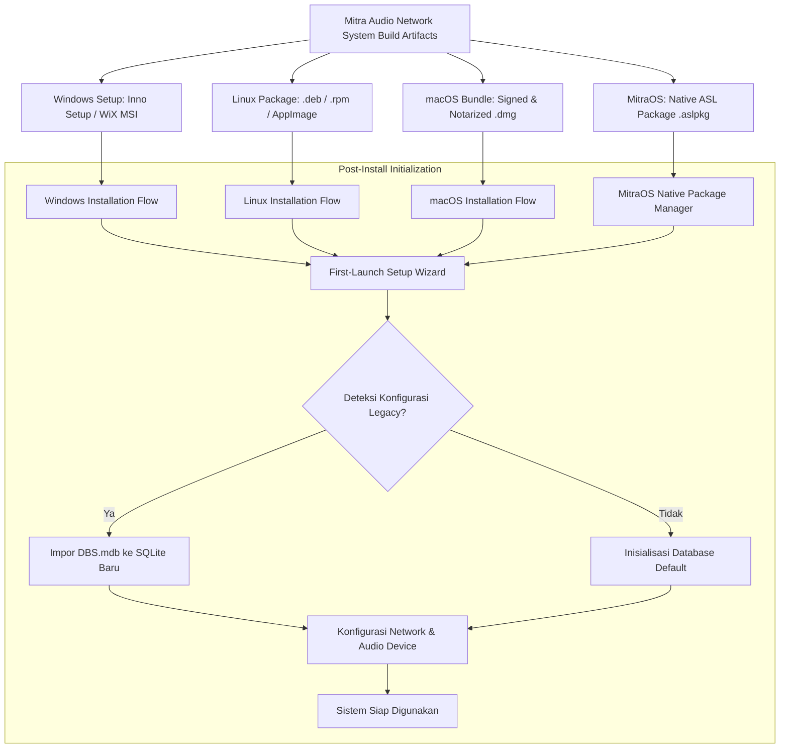

# PHASE 0.3 — INSTALLER & MULTI-PLATFORM DISTRIBUTION BLUEPRINT

**Project:** Mitra Audio Network System  
**Document Code:** `SPEC-INSTALLER-008`  
**Status:** VALIDATED (Phase 0.3 Blueprint)  

---

## 1. Arsitektur & Strategi Distribusi

Setiap target platform memiliki ekosistem packaging dan mekanisme instalasi tersendiri. Installer dirancang sejak awal agar tidak hanya menyalin berkas biner, melainkan juga menangani konfigurasi sistem, hak akses jaringan, driver soundcard, dan migrasi konfigurasi lama.

---

## 2. Rincian Paket Distribusi Per Platform

### 2.1 Windows Deployment (Priority 1)
- **Format:** Dual installer: Standalone Executable Setup (`.exe` via Inno Setup) dan Enterprise IT Installer (`.msi` via WiX Toolset).
- **Arsitektur:** Target x86 32-bit (kompatibel penuh dengan legacy Windows XP/7/10/11) dan x64 native.
- **Tindakan Otomatis Installer:**
  1. **Prerequisite Check:** Memeriksa ketersediaan driver soundcard dan ketersediaan port `2046`/`2048`.
  2. **Firewall Rule Injection:** Mendaftarkan aplikasi ke Windows Defender Firewall melalui Win32 NetFw API untuk mengizinkan paket UDP Multicast masuk tanpa memicu prompt popup pengguna.
  3. **Windows Service Registration:** Menginstal daemon background `MitraAudioService` yang mulai otomatis saat booting (`sc.exe create MitraAudioService start= auto`).
  4. **Code Signing:** Biner dan installer ditandatangani dengan EV Code Signing Certificate untuk mencegah blokir SmartScreen.
  5. **Uninstaller Bersih:** Menyediakan dialog konfirmasi untuk mempertahankan atau menghapus database konfigurasi dan berkas lisensi saat uninstall.

### 2.2 Linux Deployment (Priority 2)
- **Format:**
  - Debian/Ubuntu Package (`.deb`).
  - Red Hat/CentOS/Fedora Package (`.rpm`).
  - Standalone Portable (`AppImage`) untuk testing cepat tanpa dependensi root.
- **Tindakan Otomatis Installer:**
  1. Memasang binary ke `/usr/local/bin/mitra-audio-server`.
  2. Memasang file konfigurasi default ke `/etc/mitra-audio/mitra-audio.toml`.
  3. Memasang dan mengaktifkan service systemd:
     `systemctl enable --now mitra-audio.service`.
  4. Menambahkan permission multicast: `setcap 'cap_net_bind_service=+ep' /usr/local/bin/mitra-audio-server`.

### 2.3 macOS Deployment (Priority 3)
- **Format:** Apple Disk Image (`.dmg`) berisi drag-and-drop `Mitra Audio Network.app` dan PKG installer untuk daemon headless.
- **Arsitektur:** Universal Binary 2 (Native ARM64 Apple Silicon + Intel x86_64).
- **Keamanan & Notarisasi:**
  - Hardened Runtime diaktifkan.
  - Entitlements mikrofon: `com.apple.security.device.audio-input`.
  - Entitlements jaringan: `com.apple.security.network.client` & `server`.
  - Ditandatangani dengan sertifikat Apple Developer ID dan lolos notarisasi resmi Apple Gatekeeper.

### 2.4 MitraOS Deployment (Priority 4)
- **Format:** Native ASL Application Package (`.aslpkg` atau format flat-archive native kernel).
- **Karakteristik:**
  - Mengikuti direktori instalasi standar MitraOS (misal: `/system/apps/mitra_audio/` atau sesuai Stage F).
  - Pendaftaran service ke ASL Kernel Task Manager.
  - Manifest izin perangkat keras: `audio.dma` dan `net.multicast`.
  - Update atomik: Penggantian biner dilakukan melalui mekanisme snapshot rollback kernel.

---

## 3. First-Launch Configuration Wizard

Setelah proses instalasi selesai, aplikasi pertama kali akan memunculkan wizard konfigurasi terpandu:
1. **Langkah 1: Pemilihan Peran (Role Selection):** Memilih mode instalasi: *Dedicated Audio Server*, *Operator Station*, atau *Combined Standalone*.
2. **Langkah 2: Konfigurasi Audio:** Memilih mikrofon default dan soundcard output, disertai tes tes level suara (audio loopback check).
3. **Langkah 3: Konfigurasi Jaringan:** Memilih network interface card (NIC) yang terhubung ke switch audio multicast, dan menetapkan alamat IP server.
4. **Langkah 4: Asisten Migrasi Data:** Jika ditemukan direktori instalasi IPNBS lama, wizard menawarkan migrasi data terminal dan rekaman bel secara otomatis.
5. **Langkah 5: Registrasi Lisensi:** Menampilkan Native ID mesin dan opsi mengunggah berkas lisensi `.lic` atau mencoba mode evaluasi.
