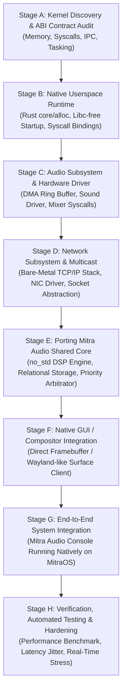

# PHASE 0.3 — MITRAOS NATIVE DEVELOPMENT ROADMAP & ASL KERNEL INTEGRATION

**Project:** Mitra Audio Network System  
**Document Code:** `ROADMAP-MITRAOS-009`  
**Status:** VALIDATED (Phase 0.3 Blueprint)  
**Target Platform:** MitraOS berbasis ASL Kernel (Priority 4)  
**Kernel Location:** `C:\asl` (Under Strict Preservation Lock — Read-Only)  

---

## 1. Kebijakan Pengembangan MitraOS

MitraOS **BUKAN** distribusi Linux, bukan turunan BSD, dan tidak memiliki dependensi pada GNU libc. MitraOS adalah sistem operasi mandiri yang dibangun di atas mikrokernel **ASL** (ditulis dalam Rust bare-metal `no_std`).

Ketiadaan driver audio atau stack jaringan TCP/IP di ASL Kernel saat ini **BUKAN** merupakan kegagalan proyek, melainkan development gap yang wajar untuk OS yang sedang berkembang.

Oleh karena itu, strategi integrasi Mitra Audio Network System ke MitraOS dilakukan secara bertahap melalui **8-Stage Engineering Roadmap**:

---

## 2. Rincian & Acceptance Criteria Per Stage

### Stage A — Kernel Discovery & ABI Contract
- **Fokus:** Mengaudit arsitektur mikrokernel ASL di `C:\asl`: model paging virtual memory, registrasi system call (`int 0x80` atau `syscall`), IPC model (message passing vs shared memory), dan format executable (ELF x86_64).
- **Deliverables:** Dokumen spesifikasi ABI ASL Kernel.
- **Acceptance Gate:** Tersedianya tabel syscall resmi dan model thread execution ASL.

### Stage B — Native Userspace Runtime
- **Fokus:** Membangun runtime minimal pengguna tanpa libc untuk aplikasi Rust:
  - Menyambungkan memory allocator `alloc` ke syscall alokasi memori ASL (`sys_mmap` / `sys_brk`).
  - Thread spawning dan thread synchronization primitives (mutex / condvar berbasis ASL futex/event).
- **Acceptance Gate:** Aplikasi tes "Hello MitraOS" dalam Rust dapat dikompilasi, dimuat, dan dieksekusi di userspace ASL.

### Stage C — Audio Architecture & Driver Integration
- **Fokus:** Merancang arsitektur audio native ASL:
  - Driver soundcard (Intel HDA / AC97 / VirtIO-Sound).
  - Kernel DMA ring buffer untuk input capture dan output playback.
  - Syscall audio: `sys_audio_open`, `sys_audio_write`, `sys_audio_read`.
- **Acceptance Gate:** Driver mampu memutar nada sinus PCM 44.1 kHz tanpa buffer underrun.

### Stage D — Network Subsystem & Multicast Socket
- **Fokus:** Mengintegrasikan networking stack ke ASL:
  - Driver Ethernet (Intel e1000 / Realtek / VirtIO-Net).
  - Implementasi bare-metal network stack (mengintegrasikan crate `smoltcp`).
  - Abstraksi soket UDP Multicast: `join_multicast_group("234.0.0.254")`.
- **Acceptance Gate:** Kernel mampu mengirim dan menerima frame UDP multicast pada port 2048 di jaringan virtual/fisik.

### Stage E — Audio Processing Engine Porting
- **Fokus:** Mengompilasi Shared Core Mitra Audio ke target `x86_64-unknown-none` atau custom target spec MitraOS.
- **Acceptance Gate:** Shared Core DSP berhasil memproses paket audio dan routing matrix di atas runtime Stage B.

### Stage F — Native GUI & Application Lifecycle
- **Fokus:** Integrasi tampilan visual antarmuka:
  - Mengembangkan driver framebuffer atau window compositor native MitraOS.
  - Mengompilasi renderer UI ringan (seperti Slint dengan backend software renderer atau embedded UI engine).
- **Acceptance Gate:** Dasbor pemantauan terminal dapat dirender pada layar native MitraOS.

### Stage G — End-to-End Mitra Audio System
- **Fokus:** Menjalankan Mitra Audio Network System lengkap pada MitraOS: fungsi server, stasiun interkom, dan penerima broadcast beroperasi secara serentak.
- **Acceptance Gate:** Terminal IP audio fisik dapat menerima siaran yang dipancarkan langsung dari mesin MitraOS.

### Stage H — Testing, Benchmark & Hardening
- **Fokus:** Uji ketahanan real-time: mengukur interrupt latency, kestabilan memory leak, dan performa throughput pada pembebanan 24/7.
- **Acceptance Gate:** Latency audio end-to-end terukur di bawah 20 ms dengan zero crash selama 72 jam pengujian terus-menerus.

---

## 3. Aturan Ketat Preservation Lock untuk MitraOS

1. **Dilarang Menyentuh `C:\asl` Sebelum Tahap Terkait:** Sumber ASL Kernel tidak boleh diedit atau dikompilasi ulang sebelum Fase Implementasi dan sebelum persetujuan resmi diberikan.
2. **Tidak Ada Emulasi Linux:** Dilarang mengimplementasikan emulator syscall Linux monolitik di ASL Kernel hanya untuk menjalankan aplikasi Linux secara instan. MitraOS harus mempertahankan integritas arsitektur mikrokernel aslinya.
