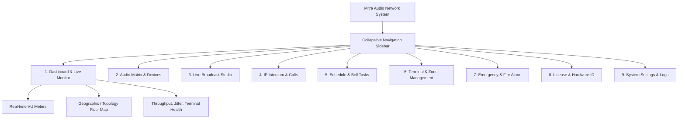

# PHASE 0.3 — PRODUCT DESIGN, DESIGN SYSTEM & UI/UX BLUEPRINT

**Project:** Mitra Audio Network System  
**Document Code:** `DESIGN-UIUX-007`  
**Status:** VALIDATED (Phase 0.3 Blueprint)  
**Target GUI:** Modern Cross-Platform Responsive Desktop & Web Interface  

---

## 1. Design System Tokens & Typography

Antarmuka Mitra Audio Network System dirancang dengan standar enterprise pro-audio console: kontras tinggi, navigasi presisi, ergonomis untuk pemantauan jangka panjang (24/7 mission critical), serta mendukung transisi mulus antara Dark Mode dan Light Mode.

### 1.1 Color Palette Tokens

| Token Name | Light Mode Value | Dark Mode Value | Penggunaan Semantik |
|---|---|---|---|
| `--color-bg-canvas` | `#F8FAFC` (Slate 50) | `#0B0F19` (Deep Navy) | Latar belakang aplikasi utama. |
| `--color-bg-surface` | `#FFFFFF` (Pure White) | `#131B2E` (Surface Navy) | Latar belakang Card, Sidebar, Modal. |
| `--color-border-subtle` | `#E2E8F0` (Slate 200) | `#1E293B` (Slate 800) | Pemisah tabel, garis batas panel. |
| `--color-primary` | `#0284C7` (Sky Blue) | `#38BDF8` (Bright Cyan) | Tombol aksi primer, indikator channel aktif. |
| `--color-success` | `#16A34A` (Green 600) | `#22C55E` (Neon Green) | Status terminal online, audio stream normal. |
| `--color-warning` | `#D97706` (Amber 600) | `#FBBF24` (Amber Gold) | Peringatan jitter, packet loss > 2%, lisensi expiring. |
| `--color-danger` | `#DC2626` (Red 600) | `#EF4444` (Vivid Crimson) | Fire Alarm darurat, terminal offline, error kritis. |
| `--color-text-main` | `#0F172A` (Slate 900) | `#F1F5F9` (Slate 100) | Judul, label utama, nilai metrik. |
| `--color-text-muted` | `#64748B` (Slate 500) | `#94A3B8` (Slate 400) | Metadata, timestamp, teks pembantu. |

### 1.2 Tipografi & Spacing
- **Font Display / Heading:** `Inter`, `Segoe UI`, `SF Pro Display`, sans-serif (Font weights: `600` Semi-Bold, `700` Bold).
- **Font Metrik / VU Meter / Jam:** `JetBrains Mono`, `Roboto Mono`, monospace (Tabular lining figures untuk pergerakan angka tanpa pergeseran layout).
- **Scale Spacing:** Grid 4px standar (`4px`, `8px`, `12px`, `16px`, `24px`, `32px`, `48px`).

---

## 2. Struktur Navigasi & Information Architecture

Aplikasi menggunakan layout **Fixed Sidebar + Dynamic Master-Detail Workspace**:

---

## 3. Spesifikasi Layar & Perilaku Fungsional Komponen

### 3.1 Live Broadcast Studio
- **Master Mic Push-to-Talk (PTT):**
  - Tombol fisik/mouse besar dengan state visual: *Idle* (Abu-abu), *Armed* (Kuning), *On-Air* (Merah menyala berkedip lembut).
  - Dilengkapi indikator VU meter stereo real-time dengan peak limiter warning (dBFS scale: `-60 dB` s/d `0 dB`).
- **Zone Selector Grid:**
  - Tombol matriks zona (misal: "Seluruh Kampus", "Lantai 1", "Gedung Lab", "Auditorium").
  - Fitur "Quick Select All" dan "Clear Selection".
  - Menampilkan jumlah terminal aktif di setiap zona sebelum siaran dimulai.
- **Audio Source Selector:**
  - Tab pilihan sumber: Mikrofon Lokal, Line-In Soundcard, Audio File Library (Playlist BGM), atau SIP Stream.

### 3.2 IP Intercom & Two-Way Calling
- **Terminal Dialer Pad:** Antarmuka angka cepat untuk memanggil nomor ekstensi terminal target.
- **Active Call Banner:** Menampilkan durasi panggilan, volume mikrofon/speaker, status codec aktif (Opus vs ADPCM), dan estimasi latency pulang-pergi (RTT dalam ms).
- **Emergency Override Button:** Tombol interupsi darurat yang secara otomatis membungkam musik latar jika ada pengumuman mendesak.

### 3.3 Dashboard Pemantauan Jaringan
- **Live Terminal Table:**
  - Kolom: ID, Nama Terminal, Alamat IP, Zona, Status (Online/Offline/Busy), Volume, Firmware, Jitter (ms), Packet Loss (%).
  - Search bar instan dan filter multi-kriteria berdasarkan status atau zona.
  - Quick action menu: Ping test, Remote Volume slider, Remote Reboot, Test Audio Beep.

### 3.4 License & Hardware ID Manager
- **Form Machine Fingerprint:** Menampilkan string Native ID unik komputer dengan tombol "Copy to Clipboard" satu kali klik.
- **Drag-and-Drop License Importer:** Area drop file `.lic` dengan preview validasi seketika (menampilkan nama pemilik lisensi, kuota terminal, dan tanggal kadaluarsa sebelum lisensi disimpan secara permanen).

---

## 4. Aksesibilitas & Responsivitas (A11y)
- Seluruh fungsi tombol krusial (seperti PTT dan Emergency Alarm) memiliki shortcut keyboard yang dapat dikustomisasi (e.g. `Spacebar` untuk PTT, `Ctrl+Shift+E` untuk Emergency).
- Rasio kontras teks terhadap latar belakang mematuhi standar **WCAG 2.1 AA** (rasio minimal 4.5:1 untuk teks normal dan 3:1 untuk teks besar).
- Layout responsif mendukung resolusi layar minimum **1024 x 768** hingga workstation multi-monitor **4K (3840 x 2160)**.
