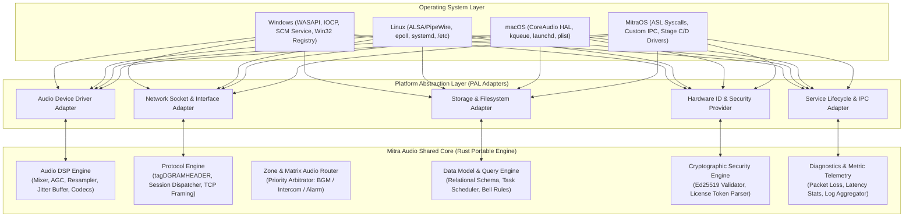

# PHASE 0.3 — SHARED CORE ARCHITECTURE & BOUNDARY DECOMPOSITION

**Project:** Mitra Audio Network System  
**Document Code:** `ARCH-SHARED-CORE-001`  
**Status:** VALIDATED (Phase 0.3 Blueprint)  
**Implementation Language:** Rust (`std` untuk Windows/Linux/macOS, `no_std` + `alloc` untuk MitraOS / ASL Kernel)  

---

## 1. Prinsip Dekomposisi & Isolasi Boundary

Salah satu anti-pattern paling berbahaya dalam sistem lintas platform adalah memaksakan seluruh fungsionalitas menjadi 100% *platform-independent*. Setiap sistem operasi memiliki model threading, I/O multiplexing, driver audio, dan skema keamanan yang berbeda secara fundamental.

Oleh karena itu, arsitektur Mitra Audio Network System menerapkan **Strict Separation of Concerns** antara **Domain Logic (Shared Core)** dan **Operating System Adapters (Platform Abstraction Layer - PAL)**.



---

## 2. Matriks Boundary: Portabilitas Modul

| Modul Subsistem | Klasifikasi Arsitektur | Alasan Teknis & Batasan Dependensi | Status Validasi |
|---|---|---|---|
| **Audio DSP & Mixing** | 100% Portable Shared Core | Matematika pemrosesan sinyal digital (resampling, gain, limiter, ring buffer, parsing frame PCM/ADPCM/Opus) tidak bergantung pada OS. | `VERIFIED` |
| **Audio Capture / Playback Driver** | Platform-Specific Adapter | Windows menggunakan WASAPI/WinMM; Linux menggunakan ALSA/PipeWire; macOS menggunakan CoreAudio; MitraOS menggunakan ASL native DMA buffer. | `VERIFIED` |
| **Protocol Serialization & Framing** | 100% Portable Shared Core | Struktur biner `tagDGRAMHEADER`, encoding big/little endian, CRC16, dan TCP command framing sepenuhnya independen dari kernel. | `VERIFIED` |
| **Network Socket & Multiplexing** | Platform-Specific Adapter | Abstraksi soket UDP Multicast dan I/O multiplexer: IOCP (`Windows`), `epoll` (`Linux`), `kqueue` (`macOS`), bare-metal `smoltcp` (`MitraOS`). | `VERIFIED` |
| **Zone Matrix & Priority Arbitrator** | 100% Portable Shared Core | Logika bisnis prioritas (Emergency > Intercom > Bell > BGM) dan routing terminal-ke-channel murni state machine di memory. | `VERIFIED` |
| **Storage & Data Management** | Hybrid (Core + Adapter) | Core menangani entity model, query, dan validasi data. Adapter menangani filesystem path dan database backend (SQLite untuk Win/Lin/Mac, raw storage untuk MitraOS Stage B). | `VERIFIED` |
| **Hardware Fingerprint (Native ID)** | Platform-Specific Adapter | Ekstraksi serial disk dan UUID motherboard bergantung pada syscall/WMI spesifik OS (`DeviceIoControl`, `/sys/class/dmi`, IOKit, ASL syscall). | `VERIFIED` |
| **License Verification Engine** | 100% Portable Shared Core | Verifikasi tanda tangan digital Ed25519 dan decoding payload lisensi murni algoritma matematika kriptografi. | `VERIFIED` |
| **Service Lifecycle & Daemon** | Platform-Specific Adapter | Windows SCM Service, Linux systemd unit, macOS launchd, dan ASL kernel task manager memiliki kontrak lifecycle yang berbeda. | `VERIFIED` |

---

## 3. Desain Kontrak Trait Rust (Platform Abstraction Layer)

### 3.1 Audio Driver Trait (`AudioBackend`)
```rust
pub trait AudioBackend: Send + Sync {
    fn enumerate_devices(&self) -> Result<Vec<AudioDeviceInfo>, AudioError>;
    fn open_input_stream(&mut self, config: &StreamConfig, callback: Box<dyn FnMut(&[f32]) + Send>) -> Result<Box<dyn StreamHandle>, AudioError>;
    fn open_output_stream(&mut self, config: &StreamConfig) -> Result<Box<dyn OutputStreamHandle>, AudioError>;
}
```

### 3.2 Network Transport Trait (`NetworkTransport`)
```rust
pub trait NetworkTransport: Send + Sync {
    fn bind_multicast(&self, group: &Ipv4Addr, port: u16, interface: Option<&Ipv4Addr>) -> Result<Box<dyn MulticastSocket>, NetworkError>;
    fn bind_tcp_server(&self, bind_addr: &SocketAddr) -> Result<Box<dyn TcpListenerStream>, NetworkError>;
    fn connect_tcp(&self, target: &SocketAddr) -> Result<Box<dyn TcpStreamHandle>, NetworkError>;
}
```

### 3.3 Hardware Identity Trait (`HardwareIdProvider`)
```rust
pub trait HardwareIdProvider: Send + Sync {
    fn query_raw_hardware_tokens(&self) -> Result<Vec<HardwareToken>, SecurityError>;
    fn compute_native_id(&self) -> Result<String, SecurityError>;
}
```

---

## 4. Analisis Dependensi Crate & Target `no_std`

Untuk menjaga portabilitas masa depan ke MitraOS (ASL Kernel), Shared Core dirancang dengan fitur conditional compilation:
- `#![cfg_attr(not(feature = "std"), no_std)]`
- Dependensi eksternal di Shared Core dibatasi pada crate yang mendukung `no_std` dengan `alloc`:
  - `ed25519-dalek` (kriptografi asimetris).
  - `byteorder` (endianness handling).
  - `ringbuf` / lockless queues (komunikasi audio real-time thread-safe).
- Fitur I/O berat seperti `tokio`, `rusqlite`, dan `cpal` diisolasi sepenuhnya pada workspace crate adapter masing-masing (`mitra-adapter-windows`, `mitra-adapter-linux`, dll.).
