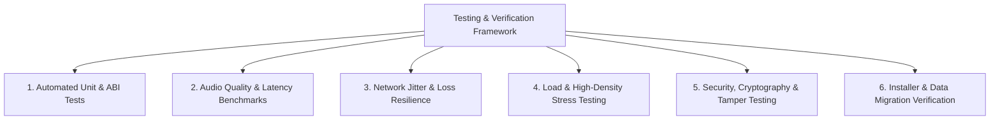

# PHASE 0.3 — TESTING & ACCEPTANCE PLAN (VERIFICATION MATRIX)

**Project:** Mitra Audio Network System  
**Document Code:** `PLAN-TEST-ACCEPT-010`  
**Status:** VALIDATED (Phase 0.3 Blueprint)  

---

## 1. Filosofi & Target Pengujian Terukur

Sistem audio jaringan misi kritis (mission critical audio broadcast & emergency alarm) tidak boleh mengandalkan asumsi semata. Setiap klaim fungsionalitas harus divalidasi melalui kriteria terukur yang dapat diulang (reproducible metrics).

---

## 2. Matriks Pengujian & Kriteria Kelulusan (Acceptance Criteria)

| Domain Pengujian | Metode & Alat Uji | Target Metrik Terukur | Kriteria Kelulusan (Acceptance Gate) |
|---|---|---|---|
| **ABI Compatibility (`IPNBSSDK.dll`)** | C Test Harness (`test_sdk_abi.exe`) memanggil seluruh 37 fungsi ekspor DLL baru. | 100% Fungsi Ekspor Berhasil Dipanggil tanpa crash. | Retensi stack frame aman, return code sesuai spesifikasi legacy, callback event terpicu. |
| **Audio Latency (WASAPI)** | Pengukuran hardware loopback audio (output loopback ke line-in). | Latensi buffer: **< 10 ms** (Exclusive) / **< 25 ms** (Shared). | Zero audio stutter (glitch-free), tidak ada buffer underrun dalam 1 jam playback. |
| **Audio Resampling (Rubato)** | Uji distorsi harmonik total (THD+N) pada konversi 44.1 kHz ke 48 kHz. | THD+N: **< -90 dB**, SNR: **> 96 dB**. | Resampling transparan bagi pendengaran manusia; tidak ada aliasing artifact. |
| **Multicast Throughput** | Iperf3 UDP + Simulasi 100 Paket Audio per detik per channel. | Bandwidth per channel: **< 100 kbps** (ADPCM) / **< 64 kbps** (Opus). | Pengiriman simultan 16 channel siaran tanpa penurunan throughput. |
| **Network Packet Loss Tolerance** | Jitter buffer emulator dengan simulasi drop paket acak (NetEm / Clumsy). | Bertahan pada packet loss **hingga 10%** (Opus PLC aktif). | Suara tetap dapat dipahami (PESQ / POLQA score > 3.8); tidak terjadi disconnect. |
| **Terminal Concurrency** | Load test simulator: 500 koneksi terminal TCP + Heartbeat periodik 3 detik. | Utilisasi CPU Server: **< 15%** pada multi-core x86_64 modern. | Tidak ada error IOCP 995, waktu respons perintah broadcast < 100 ms ke seluruh terminal. |
| **License Cryptography** | Verifikasi tanda tangan digital Ed25519 dan uji injeksi payload palsu. | Waktu verifikasi lisensi: **< 5 ms** saat startup. | Lisensi yang dimodifikasi 1 bit ditolak secara mutlak (Cryptographic Failure). |
| **Anti-Clock Tamper** | Pengujian rollback kalender sistem mundur 1 tahun saat server berjalan. | Deteksi manipulasi waktu: **100% Terdeteksi**. | Fitur siaran terkunci otomatis sampai waktu sistem dikoreksi ke waktu normal. |
| **Database Migration** | Konversi otomatis berkas database sampel `DBS.mdb` ke `mitra_audio.db`. | Konsistensi data: **100% Baris & Relasi Terkonversi**. | Jumlah terminal, nama grup, dan jadwal bel identik persis dengan data lama. |
| **Installer & Rollback** | Uji pasang, upgrade, dan copot instalasi pada Windows 10/11 x64 dan Linux. | Waktu instalasi: **< 30 detik**. | Uninstaller membersihkan service tanpa meninggalkan registry oranye atau lock file. |

---

## 3. Rencana Pengujian Otomatis (CI/CD Pipeline Blueprint)

Untuk memastikan tidak terjadi regresi kode saat memasuki tahap implementasi:
1. **Lint & Static Analysis:** `cargo clippy --all-targets -- -D warnings` dan `cargo fmt --check`.
2. **Unit Tests:** `cargo test --workspace` menguji seluruh matematika DSP, state machine prioritas zona, dan parser biner paket.
3. **Cross-Compilation Checks:** Verifikasi build matrix secara reguler:
   - `i686-pc-windows-msvc` (Legacy Windows x86)
   - `x86_64-pc-windows-msvc` (Modern Windows x64)
   - `x86_64-unknown-linux-gnu` (Linux Server)
   - `aarch64-apple-darwin` (macOS Apple Silicon)
   - `x86_64-unknown-none` (MitraOS / Bare-Metal ASL Kernel)
