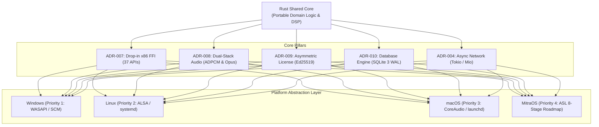

# PHASE 0.4 — FINAL CONSOLIDATED ARCHITECTURAL DECISIONS

**Project:** Mitra Audio Network System  
**Document Code:** `ADR-CONSOLIDATED-FINAL-003`  
**Status:** BINDING ARCHITECTURAL BASELINE (Phase 0.4 Final Gate)  

---

## 1. Ikhtisar Keputusan Arsitektural Mengikat

Seluruh keputusan teknis (ADR-001 s/d ADR-011) yang telah dirumuskan sepanjang fase investigasi kini dikukuhkan sebagai standar arsitektur permanen proyek Mitra Audio Network System.

---

## 2. Konsolidasi Keputusan Teknis Inti

### 1. Fondasi Bahasa Pemrograman & Toolchain (Rust Core)
- **Keputusan:** Rust ditetapkan sebagai bahasa implementasi utama untuk Shared Core dan Platform Adapters karena memberikan garansi *memory safety*, ketiadaan garbage collector (zero-cost abstractions), performa real-time deterministik untuk audio DSP, serta kemudahan kompilasi lintas platform (`i686-pc-windows-msvc`, `x86_64-pc-windows-msvc`, Linux, macOS, dan `no_std` untuk MitraOS).

### 2. Antarmuka Kompatibilitas Legacy SDK (`IPNBSSDK.dll`)
- **Keputusan:** Kompatibilitas drop-in 100% dengan aplikasi stasiun lama (`IPNBS_Station.exe`) dijamin melalui:
  - Ekspor 37 fungsi C berkonvensi `__cdecl`.
  - Urutan ordinal 1 s/d 37 dikunci melalui file Module Definition (`.def`).
  - Target build 32-bit x86 PE (`i686-pc-windows-msvc`).
  - Thread-safe callback bridging yang melindungi thread UI caller.

### 3. Kebijakan Subsystem Audio & Format Codec
- **Keputusan:** 
  - Windows adapter menggunakan **WASAPI** (Exclusive/Shared) untuk latensi rendah (< 10 ms).
  - Mengadopsi kebijakan **Dual-Stack Codec**: menyiarkan IMA-ADPCM 22.05 kHz untuk terminal horn/speaker lama dan Opus 48 kHz untuk terminal modern via engine transcoding otomatis.

### 4. Protokol Transport Jaringan & Paket Audio
- **Keputusan:**
  - Control Channel menggunakan koneksi TCP stateful (port `2046`) dengan binary framing length-prefixed.
  - Media Audio Channel menggunakan UDP Multicast (group `234.0.0.254:2048`) dengan header biner fixed 16-byte `tagDGRAMHEADER` (Magic Byte `0x5A`, Channel ID, Sequence Number, Codec ID, Priority Level).
  - Runtime asinkron menggunakan Tokio untuk Windows/Linux/macOS dan bare-metal `smoltcp` untuk MitraOS.

### 5. Sistem Keamanan & Lisensi Digital Asimetris
- **Keputusan:**
  - Menggantikan USB dongle lama Feitian ET99 dengan kriptografi digital signature **Ed25519**.
  - Master Private Signing Key diisolasi di lingkungan penerbit lisensi (Issuer Portal).
  - Public Verification Key disematkan di dalam biner aplikasi.
  - Native ID dihitung menggunakan fuzzy hardware token scoring (2 dari 3 komponen identik) yang tahan terhadap pergantian kartu jaringan atau update driver.

### 6. Persistensi Data & Migrasi Otomatis
- **Keputusan:**
  - Menggantikan Microsoft Jet 4.0 Access MDB (`DBS.mdb`) dengan **SQLite 3 WAL Mode** lokal.
  - DDL schema 3NF dengan foreign keys dan indeks optimal.
  - Menyertakan modul ekstraksi otomatis satu kali saat instalasi untuk memindahkan data terminal dan jadwal bel tanpa intervensi manual.

### 7. Strategi Pengembangan MitraOS (Priority 4)
- **Keputusan:**
  - Kode mikrokernel ASL di `C:\asl` diisolasi sepenuhnya dalam mode read-only.
  - Pengembangan native MitraOS dieksekusi secara bertahap melalui **8-Stage Roadmap** (Stage A: Discovery & ABI Contract s/d Stage H: Hardening), tanpa menggunakan lapisan kompatibilitas/emulasi Linux.
