# PHASE 0.4 — IMPLEMENTATION WORK BREAKDOWN STRUCTURE (WBS)

**Project:** Mitra Audio Network System  
**Document Code:** `PLAN-WBS-FINAL-004`  
**Status:** READY FOR PHASE 1 IMPLEMENTATION (Phase 0.4 Final Gate)  

---

## 1. Work Breakdown Structure (WBS) Hierarchy

Rencana implementasi dipecah menjadi unit-unit kerja terukur dengan ketergantungan yang jelas untuk memandu eksekusi Phase 1 ke depan:

```mermaid
graph TD
    WBS[Mitra Audio Network System - Implementation]
    
    WBS --> PKG1[Package 1: Shared Core Engine]
    WBS --> PKG2[Package 2: Windows Platform Adapter & SDK]
    WBS --> PKG3[Package 3: Modern UI & Audio Console]
    WBS --> PKG4[Package 4: Packaging & Windows Installer]
    WBS --> PKG5[Package 5: Linux Platform Adapter]
    WBS --> PKG6[Package 6: macOS Platform Adapter]
    WBS --> PKG7[Package 7: MitraOS ASL Staged Development]

    PKG1 --> WBS1_1[1.1 DSP Engine & Audio Pipeline]
    PKG1 --> WBS1_2[1.2 Network Engine & tagDGRAMHEADER]
    PKG1 --> WBS1_3[1.3 Priority Matrix & Zone Router]
    PKG1 --> WBS1_4[1.4 SQLite Storage & Jet Migrator]
    PKG1 --> WBS1_5[1.5 Ed25519 Security & Native ID]

    PKG2 --> WBS2_1[2.1 WASAPI Audio Capture Driver]
    PKG2 --> WBS2_2[2.2 IPNBSSDK.dll Drop-in 37 APIs FFI]
    PKG2 --> WBS2_3[2.3 Windows SCM Background Service]
    PKG2 --> WBS2_4[2.4 Integration Test Harness]

    PKG3 --> WBS3_1[3.1 Design System & Component Library]
    PKG3 --> WBS3_2[3.2 Live Broadcast Studio PTT]
    PKG3 --> WBS3_3[3.3 Two-Way IP Intercom Console]
    PKG3 --> WBS3_4[3.4 Schedule Bell & Matrix Manager]

    PKG4 --> WBS4_1[4.1 Inno Setup / WiX MSI Scripting]
    PKG4 --> WBS4_2[4.2 Automatic Firewall Injection]
    PKG4 --> WBS4_3[4.3 First-Launch Setup Wizard]

    PKG5 --> WBS5_1[5.1 ALSA / PipeWire Driver]
    PKG5 --> WBS5_2[5.2 systemd Daemon & DEB/RPM/AppImage]

    PKG6 --> WBS6_1[6.1 CoreAudio HAL Driver]
    PKG6 --> WBS6_2[6.2 launchd Daemon & Signed DMG]

    PKG7 --> WBS7_1[7.1 Stage A-D: ASL Audio & Net Drivers]
    PKG7 --> WBS7_2[7.2 Stage E-H: Native MitraOS App]
```

---

## 2. Rincian Paket Kerja Phase 1 (Windows Priority 1 Focus)

### Work Package 1: Mitra Audio Shared Core Engine (Rust Workspace)
- **1.1 Audio DSP Engine:** Implementasi Rubato resampler (target 48 kHz / 22.05 kHz), Automatic Gain Control (AGC), Peak Limiter, dan encoder/decoder buffer (PCM, IMA-ADPCM, Opus).
- **1.2 Network Protocol Engine:** Implementasi serializer/deserializer biner `tagDGRAMHEADER` 16-byte, adaptive jitter buffer berbasis sequence counter, dan TCP control length-prefixed framing.
- **1.3 Priority Matrix Router:** State machine arbitrase kanal siaran: Emergency Fire Alarm (Prioritas 3) > Paging/Intercom (Prioritas 2) > Scheduled Bell (Prioritas 2) > BGM (Prioritas 1).
- **1.4 Relational Storage Layer:** Implementasi koneksi SQLite 3 WAL Mode via `rusqlite`, skema 3NF 14 tabel, dan ekstraktor migrasi data dari file `DBS.mdb`.
- **1.5 Kriptografi Lisensi & Native ID:** Implementasi verifikasi signature Ed25519 (`ed25519-dalek`), fuzzy hardware tokenizer, dan anti-clock tamper detection.

### Work Package 2: Windows Platform Adapter & SDK FFI
- **2.1 Audio WASAPI Driver:** Backend audio capture (Line-In/Mic) dan render playback berlatensi rendah (< 10 ms).
- **2.2 Drop-in `IPNBSSDK.dll`:** Kompilasi dynamic library 32-bit x86 PE berkonvensi `__cdecl` yang mengekspor persis 37 fungsi dengan nomor ordinal terkunci.
- **2.3 Windows SCM Daemon:** Implementasi daemon background Windows Service `MitraAudioService` yang berjalan otomatis saat booting.
- **2.4 ABI Test Harness:** Otomasi pengujian pemanggilan seluruh 37 fungsi SDK menggunakan aplikasi uji C/C++ native untuk memverifikasi kompatibilitas 100% sebelum integrasi penuh.

### Work Package 3: Modern Desktop UI / Audio Console
- **3.1 Pro-Audio Design System:** Implementasi tema kontras tinggi Dark/Light mode, font monospace untuk VU meter stereo, dan palet warna status.
- **3.2 Live Broadcast Studio:** Tombol besar Push-to-Talk (PTT), seleksi cepat matriks zona, dan volume master slider.
- **3.3 Two-Way IP Intercom:** Antarmuka panggilan full-duplex antar terminal dengan indikator kualitas jaringan (RTT latency & packet loss).
- **3.4 Bell Scheduler & Task Manager:** Manajemen jadwal bel sekolah/kantor berbasis kalender dan pemicu pemutaran file audio otomatis.

### Work Package 4: Windows Installer & First-Launch Wizard
- **4.1 Inno Setup & WiX Installer:** Pembuatan berkas instalasi `.exe` dan `.msi` mandiri.
- **4.2 Firewall & Service Script:** Penambahan izin firewall UDP Multicast otomatis dan instalasi service background.
- **4.3 First-Launch Setup Wizard:** Antarmuka terpandu untuk pengujian loopback audio, pemilihan NIC jaringan, dan migrasi konfigurasi database lama.

---

## 3. Rencana Paket Kerja Platform Berikutnya (Phased Implementation)

- **Work Package 5 (Linux Priority 2):** Backend audio ALSA/PipeWire, integrasi daemon `systemd`, dan paket distribusi DEB/RPM/AppImage.
- **Work Package 6 (macOS Priority 3):** Backend CoreAudio HAL, service `launchd`, dan bundel Universal DMG bertanda tangan Apple Developer.
- **Work Package 7 (MitraOS Priority 4):** Eksekusi berurutan 8-stage roadmap di atas ASL Kernel (Stage A: Discovery & ABI Contract s/d Stage H: Real-Time Hardening).
