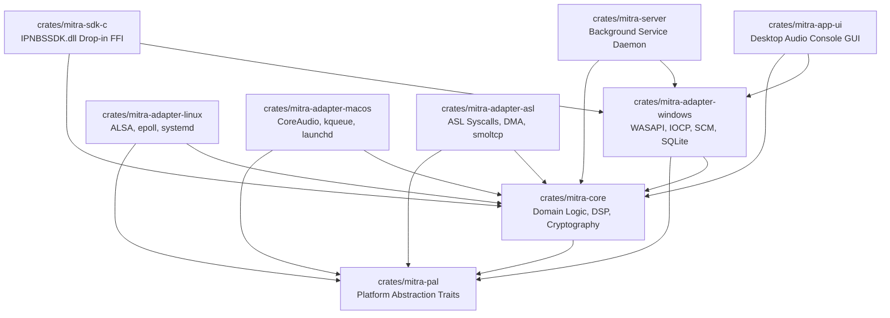

# PHASE 0.4 — MODULE DEPENDENCY GRAPH & REPOSITORY STRUCTURE

**Project:** Mitra Audio Network System  
**Document Code:** `GRAPH-DEP-REPO-005`  
**Status:** READY FOR PHASE 1 IMPLEMENTATION (Phase 0.4 Final Gate)  

---

## 1. Struktur Repositori Cargo Workspace (Rust)

Untuk menjaga modularitas dan ketiadaan siklus dependensi (*acyclic dependency graph*), repositori dirancang menggunakan arsitektur **Cargo Workspace**:

```text
C:\IPNBS\
├── Cargo.toml                       # Root Cargo Workspace definition
├── Cargo.lock
├── crates/
│   ├── mitra-core/                  # Pure Portable Domain Logic (no_std compatible)
│   │   ├── Cargo.toml
│   │   └── src/
│   │       ├── lib.rs
│   │       ├── audio/               # DSP Math, Resampler, Gain, Mixers
│   │       ├── codec/               # PCM, IMA-ADPCM, Opus, MP3 Frame Parsers
│   │       ├── protocol/            # tagDGRAMHEADER (16B), TCP Framing, CRC16
│   │       ├── router/              # Zone Matrix, Priority Arbitrator (Alarm > Intercom > BGM)
│   │       ├── storage/             # Data Models, Relational Entities, Query Engine
│   │       ├── security/            # Ed25519 Signature Verifier, Token Decoder
│   │       └── telemetry/           # Latency Stats, Jitter Calculator, Packet Loss
│   │
│   ├── mitra-pal/                   # Platform Abstraction Layer (Trait definitions)
│   │   ├── Cargo.toml
│   │   └── src/
│   │       ├── lib.rs
│   │       ├── audio.rs             # AudioBackend trait
│   │       ├── network.rs           # NetworkTransport trait
│   │       ├── hardware.rs          # HardwareIdProvider trait
│   │       └── service.rs           # ServiceLifecycle trait
│   │
│   ├── mitra-adapter-windows/       # Windows PAL Implementation (Priority 1)
│   │   ├── Cargo.toml
│   │   └── src/
│   │       ├── lib.rs
│   │       ├── audio_wasapi.rs      # WASAPI Exclusive/Shared Capture & Playback
│   │       ├── net_iocp.rs          # Tokio/Socket2 UDP Multicast & TCP IOCP
│   │       ├── hw_wmi.rs            # DeviceIoControl & WMI Native ID Generator
│   │       ├── service_scm.rs       # Windows Service Control Manager Daemon
│   │       └── db_sqlite.rs         # SQLite 3 WAL Backend & Jet MDB Extractor
│   │
│   ├── mitra-sdk-c/                 # Drop-in IPNBSSDK.dll C-ABI Wrapper (37 APIs)
│   │   ├── Cargo.toml
│   │   ├── IPNBSSDK.def             # Locks ordinals 1 to 37 strictly
│   │   └── src/
│   │       ├── lib.rs               # #[no_mangle] extern "C" __cdecl exports
│   │       └── bridge.rs            # Thread-safe bridging to mitra-core
│   │
│   ├── mitra-server/                # Server Daemon Entry Point (CLI / Service)
│   │   ├── Cargo.toml
│   │   └── src/
│   │       └── main.rs
│   │
│   ├── mitra-app-ui/                # Cross-Platform Desktop GUI / Audio Console
│   │   ├── Cargo.toml
│   │   └── src/
│   │       └── main.rs
│   │
│   ├── mitra-adapter-linux/         # Linux PAL Implementation (Priority 2)
│   │   └── src/ (ALSA/PipeWire, epoll, systemd)
│   │
│   ├── mitra-adapter-macos/         # macOS PAL Implementation (Priority 3)
│   │   └── src/ (CoreAudio HAL, kqueue, launchd)
│   │
│   └── mitra-adapter-asl/           # MitraOS ASL Kernel Adapter (Priority 4)
│       └── src/ (Stage A-D: Native Syscalls, DMA Ring Buffer, smoltcp)
│
├── tools/
│   ├── test-sdk-harness/            # Native C/C++ Test Harness for IPNBSSDK.dll
│   ├── mdb-migration-tool/          # Jet MDB to SQLite Verification Tool
│   └── license-issuer-cli/          # Offline Ed25519 Master Signing Tool (Restricted)
│
├── installer/
│   ├── windows/                     # Inno Setup (.iss) and WiX (.wxs) scripts
│   ├── linux/                       # DEB, RPM, and AppImage build configs
│   ├── macos/                       # DMG packaging and notarization scripts
│   └── mitraos/                     # .aslpkg manifest and packaging scripts
│
└── docs/
    └── rnd/                         # Phase 0.x R&D Specifications & Audit Records
```

---

## 2. Directed Acyclic Graph (DAG) Antar Modul

Diagram dependensi membuktikan tidak ada referensi silang melingkar (*circular dependencies*):



### Prinsip Desain Kunci:
- `mitra-core` sama sekali tidak mengenal sistem operasi tempat ia berjalan; ia hanya mengonsumsi trait dari `mitra-pal`.
- Modul adapter sistem operasi (`mitra-adapter-windows`, dll.) bertindak sebagai *pluggable backends* yang mengimplementasikan trait tersebut.
- `mitra-sdk-c` membungkus pemanggilan C `__cdecl` dan langsung berinteraksi dengan Shared Core secara thread-safe.
