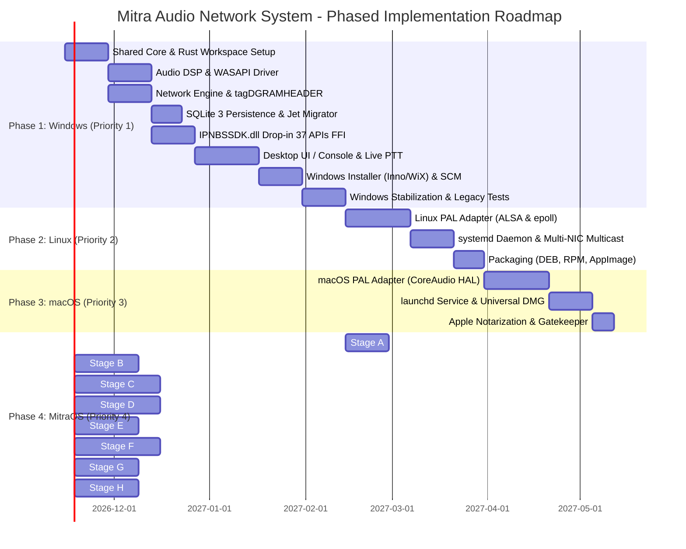

# PHASE 0.4 — MULTI-PLATFORM IMPLEMENTATION ROADMAP & SEQUENCING

**Project:** Mitra Audio Network System  
**Document Code:** `ROADMAP-EXEC-FINAL-006`  
**Status:** READY FOR PHASE 1 IMPLEMENTATION (Phase 0.4 Final Gate)  
**Platform Sequence:** 1. Windows -> 2. Linux -> 3. macOS -> 4. MitraOS (ASL Kernel)  

---

## 1. Urutan Eksekusi Platform & Garis Batas Kesiapan

Setiap platform ditangani sesuai prioritasnya tanpa memaksakan semua platform harus selesai serentak. Kesiapan platform Windows menjadi fondasi stabilitas bagi platform berikutnya.

---

## 2. Definisi Selesai (Definition of Done) Per Platform

### Platform 1: Windows (Priority 1) — Milestone Gates
1. **Core & SDK Gate:** Seluruh 37 fungsi `IPNBSSDK.dll` dapat dipanggil oleh aplikasi C/C++ native dan aplikasi legacy `IPNBS_Station.exe` tanpa error akses memori.
2. **Audio & Multicast Gate:** Siaran langsung audio mikrofon server via WASAPI terkirim melalui paket UDP multicast `234.0.0.254:2048` dan terdengar jernih pada terminal speaker horn di jaringan lokal.
3. **Database Migration Gate:** Berkas `DBS.mdb` lama berhasil dikonversi ke SQLite 3 WAL Mode tanpa kehilangan konfigurasi terminal dan jadwal bel.
4. **Installer Gate:** Berkas installer Windows memasang aplikasi, mendaftarkan Windows Service `MitraAudioService`, menyuntikkan aturan firewall, dan menyediakan first-launch wizard.

### Platform 2: Linux (Priority 2) — Milestone Gates
1. **Headless Daemon Gate:** `mitra-audio-server` berjalan stabil di bawah `systemd` pada Ubuntu 22.04/24.04 LTS dan Debian 12.
2. **Audio ALSA Gate:** Mampu menangkap audio dari soundcard ALSA hardware dan me-render stream tanpa buffer underrun.
3. **Packaging Gate:** Paket `.deb` dan standalone `AppImage` dapat dipasang dan diuji pada mesin Linux bersih.

### Platform 3: macOS (Priority 3) — Milestone Gates
1. **CoreAudio Gate:** Latensi capture dan playback audio terukur < 10 ms menggunakan Apple CoreAudio HAL.
2. **Notarization Gate:** Berkas Universal DMG (ARM64 Apple Silicon + Intel) ditandatangani dan lolos notarisasi Apple Developer tanpa peringatan keamanan Gatekeeper.

### Platform 4: MitraOS / ASL Kernel (Priority 4) — Milestone Gates
1. **Stage A & B Gate:** Aplikasi uji Rust `no_std` berjalan di userspace ASL Kernel menggunakan syscall native.
2. **Stage C & D Gate:** Kernel ASL mampu mengalirkan data audio melalui driver DMA soundcard dan mengirim paket UDP multicast via stack jaringan `smoltcp`.
3. **Stage G & H Gate:** Mitra Audio Network System berjalan secara native di atas MitraOS dan mampu membroadcast audio ke terminal fisik di jaringan.

---

## 3. Kebijakan Checkpoint & Rollback

- Setiap akhir milestone pada Phase 1 akan ditandai dengan checkpoint resmi di `CHECKPOINT.md` (e.g. `CP-PHASE-1-SDK-VERIFIED`, `CP-PHASE-1-WINDOWS-CORE-COMPLETE`).
- Jika terjadi regresi fatal pada suatu milestone, sistem dapat di-rollback ke checkpoint sebelumnya tanpa mempengaruhi integritas workspace lain atau berkas biner asli.
